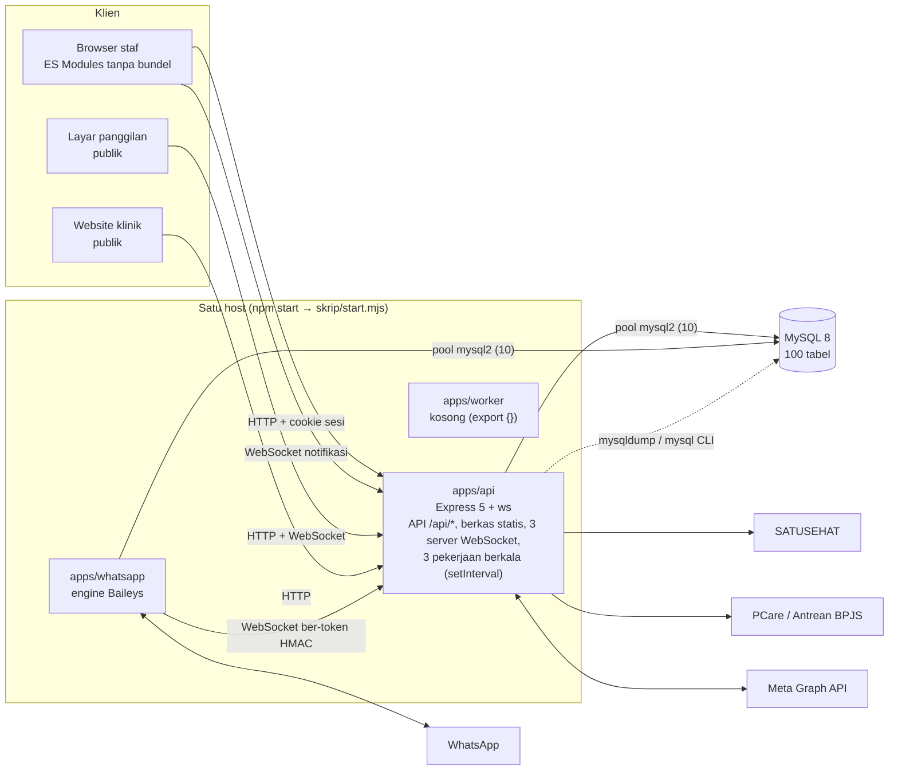
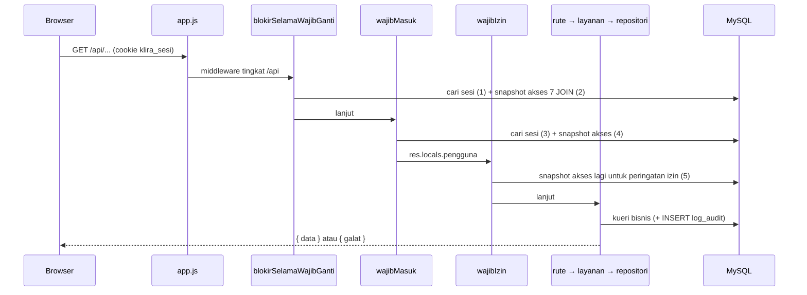
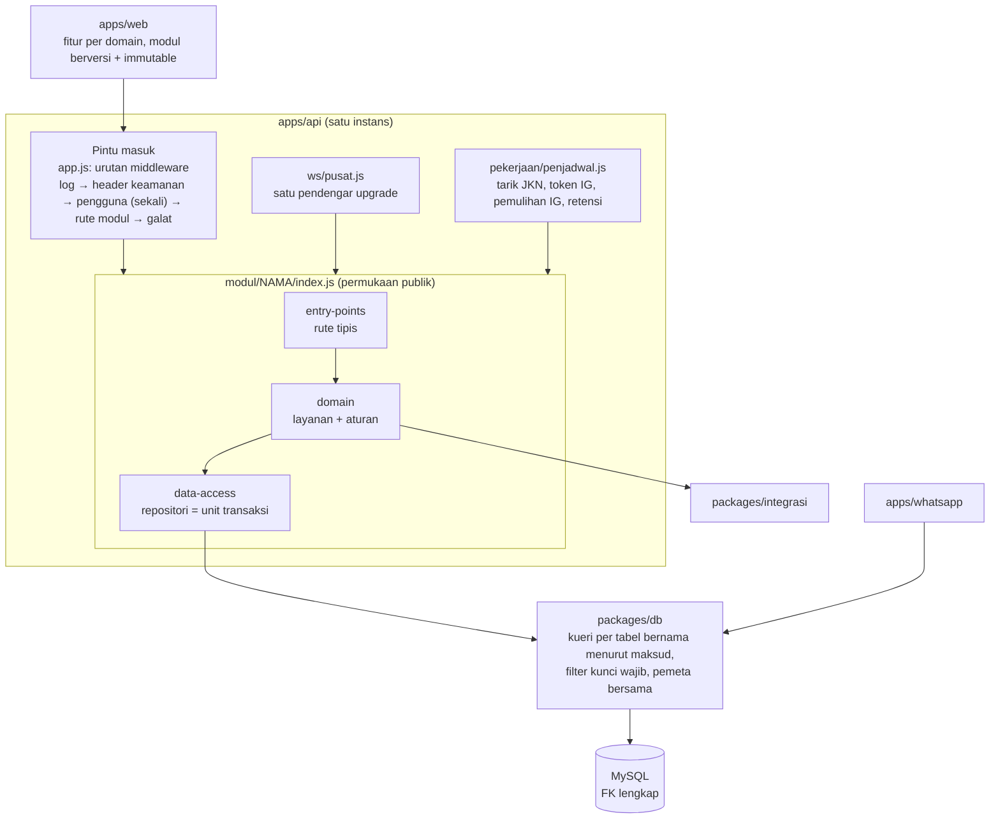
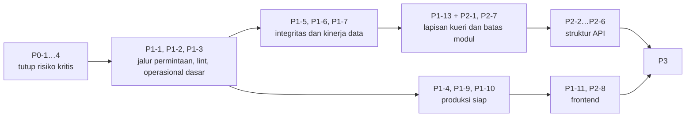

# Audit Arsitektur Klira

| | |
|---|---|
| Tanggal audit | 16 November 2026 |
| Cabang dan commit | `skrining-sesuai-formulir` @ `3d35776` |
| Cakupan | Seluruh repositori: `apps/`, `packages/`, `skrip/`, `dummy-intergrasi/`, `dokumen/`, konfigurasi akar |
| Sifat | Audit baca-saja. Tidak ada kode, konfigurasi, skema, atau data yang diubah. Satu-satunya berkas baru adalah dokumen ini. |

**Cara membaca status bukti.** Setiap temuan diberi salah satu label:

- **Terbukti**: terlihat langsung di kode atau dari perintah yang dijalankan saat audit (lint dan uji tanpa database).
- **Indikasi kuat**: mengikuti logika kode, tetapi dampak nyatanya bergantung pada data atau beban dan perlu diukur.
- **Belum terverifikasi**: bergantung pada lingkungan yang tidak ada di repositori (server produksi, konfigurasi MySQL, proxy).

---

## A. Executive Summary

Klira adalah sistem informasi klinik (rekam medis elektronik, antrean, farmasi, kasir, klaim, pelindungan data, integrasi SATUSEHAT/PCare, pesan WhatsApp/Instagram) yang dibangun sebagai **monolit modular JavaScript native (ESM) tanpa langkah build**: satu proses API Express 5 yang juga menyajikan frontend, satu proses engine WhatsApp, dan satu database MySQL.

**Kesimpulan utama: bentuk arsitekturnya sudah tepat dan tidak perlu diganti.** Modular monolith cocok untuk kondisi aktual (satu tim, satu database, satu host, 28 modul domain yang saling terkait lewat transaksi). Yang perlu dibenahi adalah mutu sambungan di dalamnya, bukan bentuk besarnya.

### Yang sudah baik

| Area | Bukti |
|---|---|
| Pembagian modul API konsisten | 28 modul di `apps/api/src/modul/<modul>/{data-access,domain,entry-points}`, dengan injeksi dependensi lewat fungsi pabrik (`buatLayananX({ repo, audit })`) sehingga layanan bisa diuji tanpa database. |
| Dasar autentikasi kuat | Kata sandi scrypt dengan garam dan `timingSafeEqual`; id sesi 256 bit acak dan hanya hash SHA-256 yang disimpan; cookie `httpOnly` + `sameSite=lax` + `secure` pada HTTPS; hash tiruan untuk menyamakan waktu respons; wajib ganti kredensial awal; sesi lama dicabut saat ganti kredensial. |
| Penanganan konkurensi pada jalur uang dan stok | `SELECT … FOR UPDATE` sebagai pernyataan pertama transaksi (kasir, stok, resep, penempatan bed), pembaruan bersyarat status, dan pengulangan pada `ER_DUP_ENTRY`/deadlock untuk nomor antrean. |
| SQL selalu berparameter | Tidak ada penyusunan SQL dari masukan pengguna; `multipleStatements: false`. |
| Validasi masukan terpusat | Skema Zod di `packages/shared/src/skema` dipakai API dan browser. |
| Rahasia terenkripsi di database | AES-256-GCM berversi (`v1:`) untuk kredensial SATUSEHAT/PCare, token Instagram, isi pesan dan media. |
| Migrasi disiplin | Berkas SQL bernomor, checksum, `GET_LOCK`, deteksi berkas berubah atau hilang, `fresh` ditolak di luar development/test. |
| Klien integrasi berbatas waktu | Semua `fetch` keluar memakai `AbortSignal.timeout` dan `redirect: 'error'`. |
| Cakupan uji luas | 165 berkas uji. Saat audit: 139 suite lulus (1.061 uji), 19 suite dilewati karena butuh database, 7 suite gagal hanya karena port 8075/8076 sedang dipakai `service-dummy` yang berjalan di mesin ini (lihat bagian L). |
| Kode mati sedikit | Dari 767 fungsi yang diekspor lapisan kueri (762 di antaranya fungsi kueri async), hanya 3 yang tidak dirujuk. |

### Masalah yang paling menentukan

| # | Masalah | Prioritas |
|---|---|---|
| 1 | Pemulihan cadangan lewat HTTP menjalankan berkas SQL unggahan apa adanya, atas seluruh database, tanpa jejak audit. | P0 ✅ selesai|
| 2 | Pengurai JSON 12 MB dipasang sebelum autentikasi; `trust proxy` mempercayai semua hop sehingga alamat IP di pembatas login dan log audit bisa dipalsukan. | P0 ✅ selesai|
| 3 | Model tenant tidak konsisten: skema multi-fasyankes, tetapi login, WhatsApp, izin, cadangan, dan reset bersifat global. | P0 (keputusan) ✅ selesai; P1 (pelaksanaan) belum|
| 4 | Lapisan kueri `packages/db` adalah hasil terjemahan mesin: 762 fungsi bernama menurut pemanggilnya, filter kunci dan tenant yang diam-diam hilang bila argumen `undefined`, parameter posisi `mulai…mulai6`, dan 163 salinan fungsi pemeta. | P1 |
| 5 | Integritas referensial lemah: 80 foreign key untuk 100 tabel, 48 tabel tanpa foreign key sama sekali. | P1 |
| 6 | Setiap permintaan terautentikasi menjalankan sedikitnya 5 kueri sebelum sampai ke penangan. | P1 |
| 7 | Tidak ada graceful shutdown, pencadangan terjadwal, pemeriksaan kesehatan database, atau pengawas proses di repositori. | P1 |
| 8 | Batas modul bocor: repositori satu modul mengimpor repositori modul lain, `data-access` mengimpor `domain`, dan ada siklus `pesan ↔ whatsapp/instagram`. | P2 |
| 9 | Pagar mutu tidak bekerja: `npm run lint` gagal dan konfigurasinya tidak memuat satu aturan pun. | P1 |

---

## B. Current Architecture

### B.1 Peta sistem



### B.2 Komponen dan tanggung jawab aktual

| Komponen | Isi | Catatan |
|---|---|---|
| `apps/api` | 207 berkas sumber. `main.js` (server HTTP, WebSocket, pekerjaan berkala), `app.js` (perakitan 28 modul, berkas statis, penangan galat), `middleware/`, `config/`, `umum/`, `modul/` | Sekaligus server frontend: `/src`, `/modul/shared`, `/modul/zod` disajikan langsung dari sumber. |
| `apps/web` | 343 berkas sumber, 274 modul JS non-uji (±1,1 MB), DOM native dengan pembantu `h()` | Tanpa bundel; peta impor di `index.html` mengarahkan `@klira/shared` dan `zod` ke rute API. |
| `apps/whatsapp` | Engine Baileys, 1 berkas utama 337 baris | Proses terpisah; berkomunikasi lewat database (antrean pesan, sewa koneksi) dan WebSocket notifikasi. |
| `apps/worker` | `export {};` + dependensi `bullmq` | Tidak berfungsi dan tidak dijalankan. |
| `packages/shared` | Skema Zod, katalog izin, status dan alur, 1.511 baris teks antarmuka | Dipakai API dan browser. |
| `packages/db` | Pool, transaksi, 99 berkas kueri per tabel (762 fungsi), migrasi, seed, enkripsi, hash kata sandi, cadangan, retensi, 80 berkas fixture uji | Satu-satunya pemilik akses MySQL. |
| `packages/integrasi` | Klien SATUSEHAT dan PCare (termasuk kripto dan `lz-string`) | Bersih, tanpa keadaan selain token di memori. |
| `dummy-intergrasi` | Layanan tiruan PCare (8075) dan SATUSEHAT (8076) + dokumentasi API | Bukan workspace npm; dipakai uji dan pengembangan. |
| `skrip/` | Pemuat `.env`, peluncur `start`/`dev`, data demo, pembuat data referensi (Python) | |

### B.3 Alur satu permintaan terautentikasi



### B.4 Pola komunikasi

| Pola | Implementasi | Penilaian |
|---|---|---|
| Browser → API | REST JSON, amplop `{ data }` / `{ galat: { kode, pesan, rincian } }`, cookie sesi | Konsisten di sebagian besar modul; WhatsApp/Instagram memakai bentuk galat sendiri (`kode: 'whatsapp'`). |
| API → Browser (push) | 3 `WebSocketServer` terpisah, hanya mengirim sinyal "ada perubahan"; data tetap diambil lewat REST berizin | Desain aman. Masing-masing memasang pendengar `upgrade` sendiri dan saling mengetahui jalur yang lain. |
| Antarmodul di API | Impor langsung fungsi/kelas + injeksi lewat `app.js`; `EventEmitter` di memori untuk layar panggilan dan kanal pesan | Hanya benar untuk satu proses API. |
| API ↔ engine WhatsApp | Tabel `wa_*` sebagai antrean dan sewa (`pemilik_engine`, `sewa_sampai`) + WebSocket ber-token | Memadai. |
| Pekerjaan berkala | 3 `setInterval` di `apps/api/src/main.js:34-41` | Menyatu dengan proses web; satu di antaranya tanpa penjaga tumpang-tindih. |

### B.5 Apakah modular monolith pilihan yang tepat?

**Ya.** Alasannya berasal dari kode, bukan preferensi:

1. Alur bisnis inti melintasi modul **di dalam satu transaksi database** (klinis → tagihan → antrean; farmasi → stok → tagihan; rawat inap → penempatan → resume). Memecahnya menjadi layanan terpisah akan mengganti transaksi lokal dengan koordinasi terdistribusi tanpa manfaat.
2. Hanya satu kebutuhan yang benar-benar butuh proses terpisah, yaitu koneksi WhatsApp yang berumur panjang, dan itu sudah dipisah.
3. Skala sasaran (klinik pratama) tidak menuntut penskalaan horizontal per modul.

Konsekuensi yang harus diterima secara sadar dan dicatat: pembatas login, kanal `EventEmitter`, dan WebSocket semuanya hidup di memori satu proses. **API hanya boleh berjalan sebagai satu instans** sampai ketiganya dipindah ke penyimpanan bersama. Ini bukan cacat untuk skala sekarang, tetapi harus menjadi aturan tertulis.

---

## C. Project Structure Assessment

### C.1 Penilaian per direktori

| Lokasi | Kondisi | Penilaian |
|---|---|---|
| `apps/api/src/modul/*` | Tiga subfolder tetap per modul | **Baik.** Mudah ditebak. Pengecualian di C.2. |
| `apps/api/src/{middleware,config,umum}` | Kecil dan jelas | **Baik.** `umum/panggil-tanpa-port.js` adalah pembantu uji yang tinggal di kode produksi. |
| `apps/api/data` | 12,9 MB JSON referensi (ICD, KFA, LOINC, wilayah) | **Cukup.** Sumber kebenaran ganda dengan tabel `kode_terminologi`, `wilayah`, `kfa_lokal` (lihat E-9). |
| `apps/web/src` | Dipilah menurut jenis teknis: `halaman/`, `modal/`, `api-klien/`, `komponen/`, `util/` | **Perlu dibenahi bertahap.** Satu fitur tersebar di 3–5 pohon; `util/` berisi logika fitur (`util/tab/tab-kasir-klaim.js`, `util/panggilan/*`). |
| `apps/whatsapp/src` | `entry-points/main.js` 337 baris + 2 berkas `domain/` | **Cukup.** Satu berkas memuat autentikasi, terima, kirim, detak, dan siklus hidup. |
| `apps/worker` | Kosong | **Hapus** (atau isi; lihat H.4). |
| `packages/db/src/data-access` | 99 berkas per tabel | Penempatan **baik**, isi **bermasalah** (bagian D). |
| `packages/db/src/uji` | 80 berkas fixture di dalam `src/` | **Cukup.** Sudah diisolasi lewat ekspor `@klira/db/uji`; lebih rapi bila keluar dari `src/`. |
| `packages/shared/src` | `skema/`, `administrasi/`, `klinis/`, `layanan/`, `pesan/`, `umum/` | **Cukup.** Batas `administrasi`/`layanan`/`umum` kabur; `akun-demo.js` ikut terkirim ke browser. |
| `dummy-intergrasi/` | Layanan tiruan + dokumentasi | Nama salah eja (`intergrasi`) dan bukan workspace. |
| `agent/` + `.claude/` (symlink) | Definisi agen | Masih menyebut TypeScript dan `dokumen/rancangan-aplikasi.md` yang tidak ada. |
| `dokumen/` | Regulasi, referensi, log migrasi | Folder dengan spasi (`referensi primer`), tidak ada README akar, `progres.md` tanpa butir centang. |

### C.2 Berkas salah tempat

| Berkas | Masalah | Tempat yang benar |
|---|---|---|
| `apps/api/src/modul/instagram/domain/koneksi.js` | Mendefinisikan rute Express di folder `domain` | `entry-points/rute-koneksi.js` |
| `apps/api/src/modul/pesan/domain/bersihkan.js` | Memasang rute (`rute.delete(...)`) dan mengimpor repositori audit | Pisah: aturan di `domain/`, rute di `entry-points/` |
| `apps/api/src/modul/kunjungan/domain/antrean-otomatis.js` | Hanya berisi panggilan `db.*` dalam transaksi | `kunjungan/data-access/` |
| `apps/api/src/modul/rekam-medis/domain/pengesahan.js`, `penunjang/domain/isi.js`, `akses/domain/mesin-izin.js` | Diimpor oleh `data-access` modulnya sendiri (arah terbalik) | Biarkan di `domain`, pindahkan pemanggilannya ke layanan (lihat D-5) |
| `apps/api/src/modul/antrean-jkn/antrean-jkn.test.js`, `uji-bantu.js` | Di akar modul, di luar pola tiga folder | `domain/` atau `entry-points/` |
| `apps/api/src/modul/akses/entry-points/repositori.integrasi.test.js` | Uji repositori di `entry-points` | `data-access/` |
| `apps/api/src/umum/panggil-tanpa-port.js` | Pembantu uji di kode produksi | `apps/api/uji/` |
| `packages/shared/src/umum/akun-demo.js` | Data demo di paket yang disajikan publik | `packages/db/src/seed/` |
| `packages/db/src/tipe.js` | `export {};` sisa TypeScript | Hapus |
| `apps/web/src/modal/modal-1/` | Folder kosong | Hapus |
| `apps/web/src/halaman/placeholder/` | Halaman sementara masih dirujuk router | Hapus setelah semua menu punya halaman |

### C.3 Penamaan

| Temuan | Contoh |
|---|---|
| Nama berkas generik berulang sehingga perlu sufiks | `kasir/domain/layanan.js` (tagihan) vs `layanan-kasir.js`; `kasir/data-access/repositori.js` vs `repositori-kasir.js`; `rekam-medis/` memiliki `layanan.js`, `layanan-rm.js`, `layanan-dokumen.js`, `layanan-addendum.js` |
| Berkas bernama `layanan.js` yang isinya bukan nama modulnya | `rekam-medis/domain/layanan.js` berisi layanan **pengesahan** |
| Sufiks angka pada fungsi | `cariKunjunganUntukKunjungan2/4/5`, `daftarLokasiUntukOpsi2`, `hitungKunjunganUntukKunjunganAda2` |
| Salah eja | `dummy-intergrasi`, variabel `courant` di `apps/web/src/app-internal.js:59` |
| Campuran bahasa pada pengenal | Sebagian besar Indonesia, sisanya Inggris (`children`, `stopping`, `changed`, `row`, `user`) terutama di modul WhatsApp/Instagram dan `skrip/start.mjs` |

---

## D. Code Architecture Assessment

### D.1 Temuan

| ID | Lokasi | Kondisi dan bukti | Masalah | Rekomendasi | Dampak | Prioritas |
|---|---|---|---|---|---|---|
| D-1 | `packages/db/src/data-access/*.js` | **Terbukti.** 762 fungsi kueri, 711 bernama `<aksi><Tabel>Untuk<Pemanggil>` (`daftarWaPercakapanUntukBuatRuteWhatsapp`). Rute WhatsApp memakai `db.cariPasienUntukBuatRuteInstagram` (`whatsapp/entry-points/rute.js`). | Nama mengikat lapisan data ke nama metode pemanggil; kueri identik diduplikasi dengan sufiks angka; tidak bisa ditemukan menurut maksudnya. | Ganti nama menurut **apa yang dikembalikan** (`cariKunjungan`, `cariKunjunganDenganPasien`), gabungkan yang identik. Kerjakan per tabel, mulai `kunjungan`, `pasien`, `pengguna`. | Navigasi kode dan penggunaan ulang jauh lebih mudah; jumlah fungsi turun. | P1 |
| D-2 | Sama | **Terbukti.** 1.409 kemunculan `(? OR kolom <=> ?)` dengan argumen `[x === undefined, x ?? null]`. Contoh: `hapusSesiUntukHapusSesi(id_hash)` di `sesi.js:39` menghapus **semua** sesi bila `id_hash` `undefined`; `cariKunjunganUntukKunjungan(id, fasyankes_id)` mengabaikan filter tenant bila `fasyankes_id` `undefined`. | Filter kunci dan tenant bersifat opsional secara diam-diam. Saat ini pemanggil selalu mengisi nilainya, tetapi satu kesalahan (properti salah ketik) mengubah "satu baris milik klinik ini" menjadi "baris pertama di tabel". | Untuk kolom kunci, `fasyankes_id`, dan kondisi `DELETE`/`UPDATE`: pakai `kolom = ?` wajib dan lempar galat bila `undefined`. Filter opsional hanya untuk parameter pencarian yang memang opsional. | Menutup satu kelas bug kebocoran lintas tenant dan penghapusan massal. | P1 |
| D-3 | `kunjungan.js:72` dan sejenisnya | **Terbukti.** `daftarKunjunganUntukCari(fasyankes_id, mulai, mulai2, status, pakai, mulai3, mulai4, mulai5, mulai6, tahap_layanan, pakai2, batas, lewati, tipe, peserta_batas)`. | 15 parameter posisi bernama mesin; urutan salah tidak terdeteksi. | Satu objek parameter bernama (`{ fasyankesId, rentang, status, tahap, halaman }`). | Kesalahan pemanggilan terlihat saat ditinjau. | P1 |
| D-4 | 21 berkas `data-access` | **Terbukti.** 163 salinan fungsi `petakt0…petaktN`; baris sampai 6.423 karakter (`pasien.js`). | Duplikasi mekanis; berkas tidak bisa ditinjau lewat diff. | Satu pembantu `kelompokkan(baris, awalan, kunci)` di `packages/db/src/pemeta.js`; SQL ditulis multi-baris. | Berkas kueri terbaca dan bisa ditinjau. | P2 |
| D-5 | `klinis`, `penunjang`, `rawat-inap`, `farmasi`, `kasir` → `kasir/data-access/repositori.js`, `kunjungan/data-access/repositori.js`, `rekam-medis/data-access/*`, `kunjungan/domain/antrean-otomatis.js` | **Terbukti** (graf impor). Repositori satu modul mengimpor repositori modul lain; 4 `data-access` mengimpor `domain` modulnya. | Batas modul hanya berupa folder. Perubahan skema tagihan menyentuh lima modul. | Tiap modul mengekspor permukaan publik di `index.js`, termasuk fungsi "dalam transaksi" yang memang dibagikan (`tagihan.sinkronItem(tx, …)`, `antrean.selesaikan(tx, …)`). Modul lain hanya mengimpor dari `index.js`. | Ketergantungan terlihat dan terbatas. | P2 |
| D-6 | `pesan ↔ whatsapp`, `pesan ↔ instagram` | **Terbukti.** `pesan/domain/bersihkan.js` mengimpor `whatsapp/domain/kanal.js` dan `instagram/domain/kanal.js`; keduanya mengimpor `pesan`. | Dependensi melingkar. | `pesan` menerima kanal lewat parameter (registri kanal) dan tidak mengimpor modul kanal. | Siklus hilang; kanal baru tanpa mengubah `pesan`. | P2 |
| D-7 | `whatsapp/` vs `instagram/` (API, db, web) | **Terbukti.** Rute 257 vs 241 baris dengan pola sama; tabel `wa_*`/`ig_*` kembar; di web `info-kontak.js` hanya berbeda 8 baris dari 22. | Logika percakapan, baca, media, retensi ditulis dua kali. Perbaikan harus dilakukan dua kali. | Satu pabrik rute percakapan `buatRutePercakapan(kanal, adaptor)`; adaptor hanya untuk perbedaan nyata (pengiriman, koneksi, webhook). Web: komponen `bersama/` berparameter kanal (sebagian sudah). | Duplikasi modul pesan hilang; perbaikan cukup dilakukan sekali. | P2 |
| D-8 | `whatsapp/entry-points/rute.js`, `instagram/entry-points/*`, `statistik/entry-points/rute.js`, `layar-panggilan/entry-points/rute.js`, `website-klinik/entry-points/rute.js` | **Terbukti.** Rute memanggil `db.*` langsung; tanpa layanan dan repositori. | Menyimpang dari pola 24 modul lain; aturan bisnis tidak bisa diuji tanpa HTTP. | Samakan pola: rute tipis → layanan → repositori. | Konsistensi; uji unit jadi mungkin. | P2 |
| D-9 | `apps/api/src/app.js` | **Terbukti.** 252 baris: ±100 impor, perakitan 28 modul, urutan middleware, berkas statis, penangan galat. `new PenampungAuditMysql()` dibuat ±30 kali; `RepositoriFarmasiMysql`, `RepositoriPengesahanMysql`, `RepositoriSatusehatMysql` dibuat dua kali. | Satu berkas memegang empat tanggung jawab; urutan pemasangan (yang menentukan keamanan) tertimbun. | Pecah: `app.js` (urutan middleware saja), `susunan.js` (perakitan), `statis.js` (frontend), `galat.js`. Tiap modul mengekspor `pasang(konteks)`. | Urutan keamanan terbaca dalam satu layar. | P2 |
| D-10 | `apps/api/src/modul/akses/data-access/repositori.js:12` | **Terbukti.** `new RepositoriIzinMysql()` di dalam `ambilAkses`, dipanggil pada setiap permintaan. | Objek dibuat per permintaan; dependensi tersembunyi. | Injeksi lewat konstruktor. | Kecil, tetapi menghapus dependensi tersembunyi. | P3 |
| D-11 | Semua `entry-points/rute*.js` | **Terbukti.** Pembantu `bungkus`, `pengguna`, `tidakAda`, `galatValidasi`, `alamatDari` didefinisikan ulang di hampir tiap berkas; `umum/hasil.js` sudah punya `galatValidasi` tetapi `keamanan/entry-points/rute.js:7` dan `akses/entry-points/rute.js` menulis ulang. | Duplikasi kecil yang menyebar. | Satu `umum/rute.js` berisi `bungkus`, `pengguna`, `kirimHasil`, `galatValidasi`, `tidakAda`. Express 5 sudah meneruskan promise yang ditolak, jadi `bungkus` bisa dihapus. | Pembantu berulang hilang; bentuk galat seragam. | P2 |
| D-12 | `apps/web/src` | **Terbukti.** Dua gaya render: templat string + `innerHTML` + `aman()` (statistik, log audit, layar panggilan, klinik publik, beranda, akses) dan pembangun DOM `h()` (sisanya). Baris sampai 2.493 karakter (`halaman/pesan/bersama/tampilan.js`: 70 baris, 23,9 KB). | Dua model mental; pada gaya `innerHTML` keamanan XSS bergantung pada disiplin memanggil `aman()` di setiap interpolasi. | Tetapkan `h()` sebagai standar untuk kode baru; halaman `innerHTML` dipindah saat disentuh. Tetapkan batas panjang baris lewat lint. | Satu pola; risiko XSS turun. | P2 |
| D-13 | `apps/web/src/halaman/daftar-pasien/panel-kunjungan.js` (36,7 KB), `modal/pemeriksaan/langkah-pemeriksaan.js` (575 baris), `modal/pasien/langkah-registrasi.js` (564 baris) | **Terbukti.** Komponen terbesar. | `panel-kunjungan.js` memuat tab Resep, Tindakan, Penutup, telaah, dan diagnosis dalam satu berkas. Dua lainnya panjang tetapi kohesif (satu alur bertahap). | Pecah `panel-kunjungan.js` per tab. Dua berkas langkah **jangan** dipecah hanya karena panjang; keadaan sudah dipisah ke `keadaan-*.js`. | Perubahan satu tab tidak menyentuh tab lain. | P2 |
| D-14 | `packages/shared/src/umum/teks.js` | **Terbukti.** 1.511 baris, 135 KB, seluruh teks antarmuka dalam satu modul yang dimuat browser pada setiap halaman, termasuk halaman publik. | Biaya unduh dan urai untuk halaman yang hanya butuh sebagian kecil. | Pecah per domain (`teks/kasir.js`, …) dengan `teks/index.js` mengekspor ulang; halaman publik mengimpor berkas spesifik. | Muatan halaman publik dan layar panggilan turun. | P3 |
| D-15 | `apps/worker`, `bullmq` | **Terbukti.** Workspace kosong, dependensi tidak dipakai, Redis tidak ada. | Dependensi dan konsep menggantung. | Hapus workspace dan dependensi. | Lockfile lebih kecil; tidak menyesatkan. | P2 |
| D-16 | `eslint.config.mjs` | **Terbukti (dijalankan).** Tidak ada aturan; `npm run lint` keluar dengan 2 galat karena direktif `@typescript-eslint/*` usang di `akses/entry-points/repositori.integrasi.test.js:6`. | Lint tidak menangkap apa pun selain galat sintaks, dan saat ini gagal. | Hapus direktif usang; aktifkan `@eslint/js` recommended + `no-unused-vars`, `no-undef`, `max-len` (longgar). | Pagar mutu kembali berfungsi. | P1 |
| D-17 | Banyak berkas | **Terbukti.** Sisa konversi TypeScript: `const __dirname = kliraFilePath(...)` yang tidak dipakai (mis. `main.js:2`), IIFE `(async () => { const _hasil = …; return …Hasil(_hasil.id, tx); })()`, ternari `(x) ? (x) : undefined`, `direktoriWebBawaan = direktoriWebNative`. | Derau yang menyulitkan pembacaan. | Bersihkan saat berkas disentuh; `no-unused-vars` akan menemukan sebagian besar. | Keterbacaan. | P3 |

### D.2 Yang tidak perlu diubah

- **Pola pabrik dan injeksi dependensi** (`buatLayananX({ repo, audit, sekarang })`): sederhana, tanpa kerangka DI, dan membuat uji mudah.
- **Tipe hasil `{ ok, data } | { ok: false, kode, pesan }`** dengan `kirimHasil`: memisahkan galat bisnis dari galat tak terduga.
- **Tanpa ORM dan tanpa bundel**: keputusan yang konsisten dengan tujuan kesederhanaan. Masalahnya ada pada mutu SQL hasil terjemahan, bukan pada ketiadaan ORM.
- **`packages/integrasi`**: kecil, terisolasi, tanpa keadaan.

---

## E. Database Architecture Assessment

### E.1 Gambaran

- 100 tabel InnoDB `utf8mb4_unicode_ci`, kunci primer `INT AUTO_INCREMENT` (kecuali tabel media ber-UUID dan `wa_auth`).
- Hampir semua tabel membawa `fasyankes_id` (pola multi-tenant satu skema).
- Catatan klinis berversi (`versi` + kunci unik `kunjungan_id, versi`), ditambah `versi_catatan`, `pengesahan_catatan` (hash), dan `addendum`.
- Uang disimpan sebagai `INTEGER` rupiah. Tepat.
- Waktu `DATETIME(3)` UTC, dipaksakan di pool (`timezone: 'Z'`, `SET time_zone`).
- Nama indeks (`_key`, `_idx`, `_fkey`) menunjukkan skema awal berasal dari Prisma; sekarang dikelola dengan SQL mentah.

### E.2 Temuan

| ID | Lokasi | Kondisi dan bukti | Masalah | Rekomendasi | Dampak | Prioritas |
|---|---|---|---|---|---|---|
| E-1 | `packages/db/migrasi/0001_awal.sql` | **Terbukti.** 80 foreign key; 48 dari 100 tabel tidak punya satu pun. Tanpa FK antara lain: `klaim.kunjungan_id`, `resume_medis.kunjungan_id`, `pengeluaran_obat.{resep_id,item_resep_id,master_obat_id}`, `item_tagihan.{order_penunjang_id,item_resep_id,tarif_layanan_id}`, `penempatan.{kunjungan_id,lokasi_id}`, `pemulangan.kunjungan_id`, `riwayat_klaim.klaim_id`, `permintaan_perbaikan.kunjungan_id`, `antrean.lokasi_id`, `kunjungan.lokasi_id`, `peserta_kunjungan.pengguna_id`. Lebih dari 60 tabel punya `fasyankes_id` tanpa FK. | Baris yatim mungkin terjadi dan database tidak akan menolaknya. Untuk rekam medis dan keuangan, integritas seharusnya dijamin database, bukan hanya aplikasi. | Migrasi bertahap menambah FK, urut risiko: (1) keuangan dan farmasi, (2) dokumen rekam medis, (3) rawat inap, (4) PDP, (5) `fasyankes_id`. Sebelum tiap migrasi jalankan kueri pencari baris yatim. `ON DELETE RESTRICT` sesuai pola yang ada. | Integritas dijamin database; kesalahan aplikasi tertangkap lebih awal. | P1 |
| E-2 | `pengguna` + `pengguna.js:127` | **Terbukti.** Unik `(fasyankes_id, username)`, tetapi login mencari `WHERE username = ? ORDER BY id LIMIT 1` tanpa `fasyankes_id`. | Bila ada dua fasyankes dengan username sama, yang ber-id lebih besar tidak pernah bisa masuk. Bertentangan dengan kunci uniknya sendiri. | Ikuti keputusan tenant (H.2). Tenant tunggal: jadikan `username` unik global. Multi-tenant: login menyertakan pengenal klinik. | Menghilangkan ambiguitas autentikasi. | P0 (keputusan) ✅ **Diputuskan (P0)**; penegakan login global mengikuti aturan satu fasyankes|
| E-3 | `wa_koneksi`, `ig_koneksi`, `wa_auth` | **Terbukti.** `id INTEGER NOT NULL DEFAULT 1`; kode memakai `ambilWaKoneksi(1)`; `wa_auth` tanpa `fasyankes_id`; rute menolak fasyankes kedua ("Nomor WhatsApp sudah dikelola fasyankes lain"). | Satu instalasi = satu nomor WhatsApp dan satu akun Instagram, di dalam skema yang berpura-pura multi-tenant. | Ikuti keputusan tenant. Tenant tunggal: dokumentasikan. Multi-tenant: kunci per `fasyankes_id` dan satu engine per fasyankes. | Model data jujur terhadap perilaku. | P1 ✅ **Diputuskan (P0)**; model data tetap, dijaga aturan satu fasyankes|
| E-4 | `fasyankes` | **Terbukti.** Tabel `fasyankes` memiliki kolom `fasyankes_id` dengan indeks unik, di samping `id`. | Dua pengenal untuk satu entitas; FK tabel lain merujuk `id`. | Pastikan pemakaiannya; bila selalu sama dengan `id`, hapus kolomnya. | Mengurangi kebingungan. | P3 |
| E-5 | `izin`, `teks_persetujuan` | **Terbukti.** `fasyankes_id` nullable; unik `izin(fitur, aksi, cakupan)` global. | Katalog izin global, sedangkan `jenis_akun` per fasyankes. Konsisten hanya jika izin memang katalog sistem. | Jika katalog sistem: hapus `fasyankes_id` dari `izin`. | Skema mencerminkan maksud. | P3 |
| E-6 | `kunjungan.js:72` (daftar pasien), `pengguna.js` (snapshot akses) | **Indikasi kuat.** 88 `LEFT JOIN (SELECT b.* FROM tabel b WHERE TRUE) tN`; 10 di antaranya memakai `ROW_NUMBER() OVER (PARTITION BY …)` atas seluruh tabel (`peserta_kunjungan` pada daftar pasien); pengurutan memakai subkueri `EXISTS` per baris. | Tabel turunan ber-fungsi jendela tidak dapat digabung optimizer, sehingga seluruh `peserta_kunjungan` dimaterialisasi setiap daftar pasien dibuka. Biaya tumbuh seiring umur data. | Jalankan `EXPLAIN ANALYZE` pada 10 kueri terpanas (daftar pasien, antrean, snapshot akses, daftar resep, tagihan). Tulis ulang yang memindai penuh menjadi `JOIN` langsung ke tabel dengan filter `IN (id halaman ini)`. | Waktu muat daftar pasien stabil terhadap pertumbuhan data. | P1 |
| E-7 | Indeks | **Terbukti** dari DDL, dampak **perlu diukur**. Daftar pasien menyaring `kunjungan` menurut `fasyankes_id` + rentang `mulai`, tetapi indeks yang ada hanya `(fasyankes_id, tahap_layanan)` dan `(pasien_id)`. `peserta_kunjungan` tanpa indeks `(kunjungan_id, tipe)`. `pasien` tanpa indeks `nomor_hp` dan `jkn_nomor_kartu` bila dicari. 81 kueri `LIKE ?`. | Pemindaian per fasyankes saat riwayat kunjungan membesar. | Tambah `kunjungan(fasyankes_id, mulai)`; tinjau sisanya dengan `EXPLAIN` sebelum menambah. Jangan menambah indeks tanpa bukti. | Kueri daftar harian tetap cepat. | P1 |
| E-8 | `wa_media`, `ig_media`, `wa_pesan.isi`, `wa_koneksi.qr` | **Terbukti.** Media disimpan sebagai base64 → AES-GCM → base64 dalam `LONGTEXT`, sampai 8 MB per berkas (`whatsapp/entry-points/rute.js:176-185`). | Dua lapis base64 menambah ±78% ukuran; membengkakkan database, cadangan `mysqldump`, dan memori saat dibaca. Bergantung pada `max_allowed_packet` (**belum terverifikasi**). | Jangka pendek: enkripsi biner ke `LONGBLOB` (satu lapis). Jangka panjang: berkas terenkripsi di disk dengan metadata di database. Retensi sudah ada dan harus tetap berjalan. | Ukuran database dan cadangan turun signifikan. | P2 |
| E-9 | `apps/api/data/*.json` vs tabel `kode_terminologi`, `wilayah`, `kfa_lokal` | **Terbukti.** ICD diimpor saat proses mulai (±3,1 MB JSON), KFA/LOINC/wilayah (±9,9 MB) dimuat malas lalu ditahan selamanya; tabel `kode_terminologi` juga dipakai untuk pencarian kamus (`klinis/data-access/repositori.js:328-339`). | Dua sumber kebenaran untuk data referensi yang sama; ±13 MB JSON menjadi puluhan MB objek di heap. | Pilih satu: data referensi hidup di tabel (sudah ada seed-nya) dan JSON hanya bahan seed; atau tetap di memori dan hapus tabelnya. Rekomendasi: tabel, karena pencarian berhalaman sudah ada. | Memori lebih kecil; satu sumber kebenaran. | P2 |
| E-10 | `riwayat_backup` | **Terbukti.** Hanya dibaca (`hitung…`, `daftar…`); tidak ada fungsi yang menulis. | Fitur riwayat cadangan tidak pernah terisi. | Catat setiap unduh, pulihkan, reset (lihat F-1). | Jejak operasi cadangan ada. | P0 (bagian dari F-1) ✅ **Selesai (P0)**|
| E-11 | `log_audit` | **Terbukti.** Tidak ada fungsi ubah/hapus di kode (hanya-tambah di tingkat aplikasi), tetapi tidak ada FK ke `pengguna`, dan user database aplikasi tetap bisa `UPDATE`/`DELETE`. | Sifat hanya-tambah tidak dipaksakan database; pemulihan cadangan menimpa log. | Cabut hak `UPDATE`/`DELETE` pada `log_audit` untuk user aplikasi, atau tambah trigger penolak. Ekspor berkala ke luar host. | Log audit tahan terhadap aplikasi yang bermasalah. | P2 |
| E-12 | `antrean.pcare_no_urut` (`0007`) | **Terbukti.** Dipakai mencegah pendaftaran PCare ditarik dua kali, tetapi indeksnya bukan unik. | Pencegahan duplikat bergantung pada pemeriksaan aplikasi dan kunci baris pasien. | Jadikan unik `(fasyankes_id, tanggal, jenis_poli, pcare_no_urut)` setelah memastikan tidak ada duplikat. | Idempoten dijamin database. | P2 |
| E-13 | `kunjungan/domain/layanan.js:39-51` | **Terbukti.** Pendaftaran penunjang-saja: kunjungan dan antrean di-commit dulu, order lab dibuat setelahnya di luar transaksi; bila gagal, galat dikembalikan tetapi kunjungan tetap ada. | Kunjungan LAB tanpa order dan tanpa tagihan bisa tertinggal. | Buat order di dalam transaksi yang sama (fungsi `buatOrderDalam(tx, …)` dari modul penunjang). | Tidak ada kunjungan setengah jadi. | P1 |
| E-14 | `packages/db/src/koneksi.js` | **Terbukti.** `connectionLimit: 10`, antrean tak terbatas, tanpa `connectTimeout`/`enableKeepAlive` eksplisit; dua proses → sampai 20 koneksi. | N+1 (lihat G-3) dapat mengisi pool; tanpa batas antrean, permintaan menumpuk tanpa gagal cepat. Batas `max_connections` server **belum terverifikasi**. | Jadikan konfigurasi (`DB_POOL`), set `queueLimit` wajar dan `enableKeepAlive`. | Degradasi terkendali saat database lambat. | P2 |
| E-15 | `packages/db/src/cadangan/index.js:15` | **Terbukti.** Cadangan hanya membaca `DATABASE_URL`; pool juga menerima `DB_HOST`/`DB_USER`/…; `.env` hanya berisi `DB_*`, dan `DATABASE_URL` disusun oleh `skrip/dengan-env.mjs`. | API yang dijalankan tanpa pembungkus (mis. langsung oleh pengawas proses) akan gagal pada cadangan dengan `Invalid URL`. | Satu fungsi konfigurasi database dipakai pool dan cadangan. | Perilaku sama apa pun cara menjalankannya. | P2 |
| E-16 | Trigger `kunjungan_catat_*` | **Terbukti.** Riwayat tahap layanan ditulis trigger. | Logika di dua tempat (aplikasi dan trigger), tetapi menjamin tidak ada perpindahan tahap yang lolos. Dapat diterima. | Pertahankan; dokumentasikan di README db. | Tidak ada. | Tidak perlu diubah |

### E.3 Strategi migrasi

Baik dan tidak perlu diganti. Dua catatan:

1. Tidak ada `down()`. Dapat diterima, asal **cadangan sebelum migrasi** menjadi langkah rilis tertulis.
2. Migrasi `0010` membuat tabel dan `0011` menghapusnya. Selama aplikasi belum rilis produksi, riwayat seperti ini boleh diringkas ke `0001`; setelah rilis, tidak boleh.

---

## F. Security Assessment

### F.1 Temuan

| ID | Lokasi | Kondisi dan bukti | Masalah | Rekomendasi | Dampak | Prioritas |
|---|---|---|---|---|---|---|
| F-1 | `keamanan/entry-points/rute.js:41-70`, `packages/db/src/cadangan/index.js` | **Terbukti.** `POST /api/cadangan/pulihkan` menyalurkan badan permintaan ke berkas lalu ke klien `mysql`; pemeriksaan isi hanya regex pada 4 KB pertama. `GET /cadangan/unduh` mengalirkan `mysqldump` seluruh database. Ketiga rute hanya butuh izin `akses`/`perbaikan` dan **tidak menulis log audit** maupun `riwayat_backup`. Tidak ada batas ukuran unggahan. | (a) Pemegang izin `akses` dapat menjalankan SQL sembarang dengan hak user aplikasi. Klien juga menjalankan baris `\!` dari isi berkas sebagai perintah shell di host; ini **terverifikasi** pada klien MariaDB 10.11 yang terpasang (dengan `echo`), dan hilang dengan opsi `--sandbox`. (b) Seluruh data pasien bisa diunduh tanpa jejak. (c) Operasi berlaku atas seluruh database, bukan fasyankes pemanggil. | 1) Catat ketiga operasi ke `log_audit` dan `riwayat_backup` sebelum dijalankan. 2) Pulihkan dan reset dipindah ke CLI operator; rute HTTP dimatikan secara bawaan dan hanya hidup dengan variabel lingkungan eksplisit. 3) Bila tetap lewat HTTP: jalankan klien dengan perintah `system` dimatikan, batasi ukuran, wajibkan konfirmasi kata sandi ulang. 4) Izin tersendiri (`cadangan`), bukan `akses`. | Menutup jalur eskalasi dari admin aplikasi ke database/host dan memberi jejak atas ekspor data. | **P0** ✅ **Selesai (P0)**|
| F-2 | `apps/api/src/app.js:106-107` | **Terbukti.** `express.json({ limit: '12mb' })` untuk `/api/instagram` dan `/api/whatsapp` dipasang sebelum middleware autentikasi apa pun. | Klien tanpa sesi dapat memaksa server mengurai JSON 12 MB berulang kali (CPU dan memori). | Pasang pengurai besar di dalam router setelah `wajibMasuk`, hanya pada rute kirim media. | Menutup vektor DoS tanpa autentikasi. | **P0** ✅ **Selesai (P0)**|
| F-3 | `apps/api/src/app.js:105` | **Terbukti.** `app.set('trust proxy', true)`. | Express mengambil alamat paling kiri dari `X-Forwarded-For`, yang dikendalikan klien. Pembatas per alamat (`batasAlamat: 20`) bisa dilewati dan alamat di `log_audit` bisa dipalsukan. | Set jumlah hop atau alamat proxy yang nyata (mis. `loopback`). Topologi proxy **belum terverifikasi**. | Pembatas dan audit dapat dipercaya. | **P0** ✅ **Selesai (P0)**|
| F-4 | Lintas area | **Terbukti.** Login global (E-2), WhatsApp/Instagram tunggal (E-3), cadangan/pulihkan/reset seluruh database (F-1), semua di dalam skema ber-`fasyankes_id`. | Jika dua klinik berbagi satu database, admin klinik A dapat mengunduh, menimpa, atau menghapus data klinik B. | Putuskan dan tulis model tenant (H.2). Rekomendasi: **satu instalasi = satu fasyankes**, dijaga oleh pemeriksaan saat seed dan saat mulai. | Menghapus seluruh kelas risiko lintas tenant. | **P0** (keputusan) ✅ **Selesai (P0)**|
| F-5 | `apps/api/src/middleware/izin.js:16` | **Terbukti.** `punyaIzin(pengguna, fitur, aksi)` tanpa `cakupan`; di luar modul akses, `cakupan` tidak pernah diperiksa. | Model izin menyimpan `unit` vs `layanan`, tetapi API tidak membedakannya. Pemegang `rekam-medis/lihat/unit` dapat melihat semua pasien fasyankes. | Tegakkan (filter menurut peserta kunjungan/unit) atau hapus konsepnya dan sampaikan terbuka di UI. Jangan biarkan kontrol yang tampak ada tetapi tidak bekerja. | RBAC sesuai yang dijanjikan antarmuka. | P1 |
| F-6 | `whatsapp/entry-points/rute.js`, `instagram/entry-points/rute.js` | **Terbukti.** Kirim pesan, ubah koneksi, dan hapus percakapan semuanya hanya butuh `whatsapp/lihat` (katalog memang hanya punya satu izin untuk kanal ini). | Tidak ada pemisahan baca dan tulis untuk kanal yang membawa data pasien. | Tambah aksi `input` (kirim) dan `perbaikan` (koneksi, hapus). | Hak minimum bisa diterapkan. | P2 |
| F-7 | `packages/shared/src/skema/umum.js:52`, `apps/api/src/app.js:221` | **Terbukti.** `KREDENSIAL_AWAL_BAWAAN = { username: 'pimpinan', kataSandi: 'klira-awal-2026' }` berada di paket yang disajikan tanpa autentikasi di `/modul/shared/`; `umum/akun-demo.js` dan berkas `*.test.js` ikut tersaji. | Kredensial awal diketahui publik. Sudah ada mitigasi (wajib ganti saat masuk pertama), tetapi instalasi baru yang terbuka ke internet sebelum pemilik masuk dapat diambil alih. | Seed menolak berjalan tanpa `KATA_SANDI_AWAL` di luar development; pindahkan konstanta dan data demo ke `packages/db`; jangan sajikan berkas uji. | Menutup jendela pengambilalihan instalasi baru. | P1 |
| F-8 | `apps/api/src/app.js` | **Terbukti.** Tidak ada header keamanan global (CSP, `X-Frame-Options`/`frame-ancestors`, `X-Content-Type-Options`, HSTS, `Referrer-Policy`); hanya rute media yang memasang CSP. | Clickjacking mungkin; tidak ada lapis kedua bila terjadi XSS. Header dari proxy **belum terverifikasi**. | Satu middleware kecil buatan sendiri (tanpa dependensi baru). CSP ketat memungkinkan karena tidak ada skrip inline selain peta impor (beri hash). | Pertahanan berlapis untuk aplikasi berisi data kesehatan. | P1 |
| F-9 | `akses/domain/pembatas.js` | **Terbukti.** Pembatas login di memori proses; tidak ada pembatas untuk rute lain. | Hilang saat restart; rute publik (`/api/publik/layar-panggilan/:id`, website klinik, webhook) dan WebSocket publik tanpa batas koneksi. | Pembatas ringan di memori untuk rute publik dan batas koneksi WebSocket per alamat. Cukup selama satu instans. | Ketahanan terhadap penyalahgunaan dasar. | P2 |
| F-10 | `packages/db/src/keamanan/enkripsi.js`, `whatsapp/entry-points/websocket.js:14` | **Terbukti.** Satu `KUNCI_ENKRIPSI`, format `v1:` tanpa pengenal kunci; kunci yang sama diturunkan (HMAC berlabel) menjadi token engine. | Tidak ada jalur rotasi kunci; kehilangan kunci berarti kehilangan semua rahasia dan pesan. Penurunan token berlabel dapat diterima. | Tambah pengenal kunci pada format (`v2:<id-kunci>:…`) dan dukung beberapa kunci dekripsi. Dokumentasikan penyimpanan cadangan kunci terpisah dari cadangan database. | Rotasi mungkin tanpa migrasi besar. | P2 |
| F-11 | `pasien` dan tabel klinis | **Terbukti.** NIK, nama, alamat, dan isi klinis tersimpan teks polos; enkripsi kolom hanya untuk rahasia integrasi dan pesan. | Perlindungan data diam sepenuhnya bergantung pada enkripsi disk dan cadangan (**belum terverifikasi**). Berkas `mysqldump` hasil unduh tidak terenkripsi. | Pastikan enkripsi disk di host; enkripsi berkas cadangan sebelum meninggalkan server. Enkripsi kolom NIK tidak direkomendasikan saat ini karena mematikan pencarian. | Kepatuhan pelindungan data kesehatan. | P1 (operasional) |
| F-12 | `akses/domain/layanan.js` | **Terbukti.** Masa sesi mutlak (bawaan 12 jam), tanpa batas waktu menganggur; scrypt `N = 16384`. | Dapat diterima. Stasiun kerja bersama di klinik lebih aman dengan batas menganggur; `N` di batas bawah rekomendasi saat ini. | Opsional: batas menganggur yang bisa diatur; naikkan `N` untuk hash baru (format hash sudah menyimpan `N`). | Penguatan. | P3 |
| F-13 | CSRF | **Terbukti.** Tanpa token CSRF; perlindungan dari `sameSite=lax` dan pengurai yang hanya menerima `application/json`. WebSocket memeriksa `Origin`. | Memadai untuk peramban modern. Rute pulihkan menerima tipe konten apa pun (tetap terlindung `sameSite`). | Tambahan murah: tolak permintaan non-GET yang `Origin`-nya bukan `BASE_URL`. | Pertahanan berlapis. | P3 |

### F.2 Autentikasi: perlu dibangun ulang?

**Tidak.** Implementasi sesi, hash, pembatas, dan alur ganti kredensial sudah memadai. Yang perlu dikerjakan ada di sekelilingnya: kepercayaan proxy (F-3), cakupan izin (F-5), kredensial awal (F-7), dan efisiensi pemuatan pengguna (G-1).

---

## G. Performance & Reliability Assessment

| ID | Lokasi | Kondisi dan bukti | Status | Masalah | Rekomendasi | Prioritas |
|---|---|---|---|---|---|---|
| G-1 | `app.js:127`, `middleware/auth.js`, `middleware/izin.js`, `akses/domain/layanan-izin.js:251` | `blokirSelamaWajibGanti` dan `wajibMasuk` masing-masing memanggil `layanan.saya()` (kueri sesi + snapshot akses 7 JOIN); `wajibIzin` memanggil `catatTindakan` yang mengambil snapshot ketiga kalinya. | **Terbukti** | ≥ 5 kueri per permintaan sebelum logika bisnis; ±2,5 kali lipat dari yang diperlukan. | Muat pengguna sekali dalam satu middleware `/api` ke `res.locals`; dua penjaga lain hanya membaca. Simpan snapshot yang sama untuk evaluasi peringatan. Opsional: cache 5–10 detik per id sesi yang dibatalkan saat izin berubah. | P1 |
| G-2 | `apps/api/src/app.js:210-222` | Semua modul browser disajikan `Cache-Control: no-store`; frontend 274 modul + `@klira/shared` + `zod`, tanpa bundel. | **Terbukti** (konfigurasi); jumlah permintaan per halaman **perlu diukur** | Setiap muat halaman mengunduh ulang seluruh graf modul secara berantai. Terasa pada koneksi klinik yang lambat. | Tetap tanpa bundel, tetapi beri versi: sajikan di `/v/<hash-rilis>/src/...` dengan `immutable`, dan `index.html` tetap `no-store`. Tambahkan `modulepreload` untuk modul inti. | P1 |
| G-3 | `whatsapp/entry-points/rute.js:56-66` (sama di Instagram), `kunjungan/data-access/repositori.js:192-200` | Hitung belum dibaca dijalankan per percakapan (sampai 200 per halaman); `petakanAntrean` 3 kueri berurutan. | **Terbukti** | N+1: satu permintaan daftar percakapan bisa menjalankan 201 kueri pada pool berisi 10. | Satu kueri agregat `GROUP BY percakapan_id`. | P1 |
| G-4 | `apps/api/src/main.js` | Tidak ada penangan `SIGTERM`/`SIGINT`, `server.close()`, `tutupPool()`, `uncaughtException`, atau `unhandledRejection` di API (engine WhatsApp punya). | **Terbukti** | Saat dihentikan, permintaan berjalan terputus dan WebSocket tidak ditutup rapi. Transaksi yang belum commit dibatalkan MySQL (data aman), tetapi klien menerima galat jaringan. | Penangan sinyal: berhenti menerima koneksi, tunggu permintaan aktif (batas 10–15 detik), tutup WebSocket, hentikan pekerjaan berkala, tutup pool. | P1 |
| G-5 | `skrip/start.mjs` | Bila satu proses anak mati, semua dihentikan; tidak ada berkas pengawas proses (systemd, Docker, pm2) di repositori. | **Terbukti** (repositori); cara produksi dijalankan **belum terverifikasi** | Engine WhatsApp yang jatuh ikut menjatuhkan API. Tanpa pengawas, layanan tidak pulih sendiri. | Dua unit layanan terpisah dengan restart otomatis (H.5). `npm start` tetap untuk pengembangan. | P1 |
| G-6 | Repositori | Cadangan hanya manual lewat tombol unduh; `backup/` di `.gitignore`; tidak ada skrip terjadwal. | **Terbukti** (repositori); cron di server **belum terverifikasi** | Tanpa jadwal dan salinan di luar host, kehilangan disk berarti kehilangan rekam medis. | Skrip `skrip/cadangan.mjs` (mysqldump → kompres → enkripsi → luar host) dijalankan timer; uji pemulihan berkala; catat ke `riwayat_backup`. | P1 |
| G-7 | `apps/api/src/app.js:120` | `/api/kesehatan` selalu `{ status: 'ok' }` tanpa menyentuh database. | **Terbukti** | Pemantau melihat sehat walau database mati. | Tambah `/api/kesehatan/siap` yang menjalankan `SELECT 1` berbatas waktu. | P1 |
| G-8 | Seluruh API | 11 `console.*`; tanpa log permintaan, id korelasi, atau tingkat log. | **Terbukti** | Insiden sulit ditelusuri; tidak ada data latensi atau tingkat galat. | Satu modul `umum/log.js` (JSON satu baris ke stdout, tanpa dependensi) + middleware log permintaan (metode, pola rute, status, durasi, id pengguna; tanpa badan). | P1 |
| G-9 | `apps/api/src/main.js:39` | `setInterval(…tarikSemua(), 30000)` tanpa penjaga tumpang-tindih; `tarikSemua` berurutan per fasyankes dengan panggilan keluar berbatas waktu. | **Terbukti** (tanpa penjaga); tumpang-tindih nyata **perlu diuji** | Bila PCare lambat, putaran baru mulai sebelum yang lama selesai. Duplikat pendaftaran dicegah kunci baris pasien, tetapi beban dan koneksi menumpuk. | Penjadwal kecil `pekerjaan/penjadwal.js`: satu putaran per pekerjaan, jeda dihitung setelah selesai, galat dicatat, berhenti saat shutdown. | P2 |
| G-10 | `kunjungan/domain/layanan.js:58-59`, `102` | Sinkron IHS dan kabar antrean BPJS ditunggu di dalam permintaan pendaftaran dan panggil. | **Terbukti** | Latensi layanan luar (sampai batas waktu klien) menjadi latensi loket. Kegagalan memang tidak menggagalkan tindakan. | Jalankan setelah respons dikirim, dengan status tersimpan (`antrean.bpjs_status` sudah ada) dan pengulangan oleh pekerjaan berkala. | P2 |
| G-11 | `EventEmitter` kanal, `PembatasPercobaan`, peta klien WebSocket | Keadaan di memori proses. | **Terbukti** | API tidak boleh dijalankan lebih dari satu instans. Bukan masalah untuk skala sekarang. | Tulis sebagai batasan arsitektur; tinjau hanya bila butuh instans kedua. | Catatan |
| G-12 | `apps/api/data` | ±13 MB JSON ditahan di heap seumur proses (E-9). | **Terbukti** (pemuatan); ukuran heap **perlu diukur** | Memori dasar proses lebih tinggi dari perlu. | Lihat E-9. | P2 |
| G-13 | Tiga `WebSocketServer` | Detak tiap 20–30 detik memanggil `akses.saya()` (2 kueri) per klien terhubung. | **Terbukti** | Wajar untuk puluhan klien; perlu diingat bila G-1 menambah cache. | Pakai jalur pemuatan pengguna yang sama dengan G-1. | P3 |
| G-14 | Kebocoran memori | Peta pembatas dibatasi (`maksCatatan`), klien WebSocket dilepas saat `close`, timer di-`unref` dan dibersihkan. | **Tidak ditemukan** lewat pembacaan kode | Tidak ada kebocoran yang terlihat; pengujian beban jangka panjang **belum dilakukan**. | Uji rendam 24 jam dengan pemantauan heap sebelum produksi. | P3 |
| G-15 | `npm test` | Uji klien integrasi membuka port tetap 8075/8076. | **Terbukti (dijalankan)** | 7 suite gagal bila `service-dummy` sedang berjalan; hasil uji bergantung pada keadaan mesin. | Uji memakai ulang layanan yang sudah berjalan bila port terpakai dan identitasnya cocok, alih-alih gagal. Port tetap dipertahankan. | P2 |

---

## H. Recommended Target Architecture

### H.1 Prinsip

1. **Tetap monolit modular, dua proses, satu database.** Tidak menambah layanan, antrean pesan, ORM, bundel wajib, atau TypeScript.
2. **Batas modul ditegakkan lewat satu pintu** (`index.js` per modul), bukan lewat kerangka.
3. **Database menjamin integritas**; aplikasi menjamin aturan bisnis.
4. **Satu jalur untuk hal lintas-potong**: pemuatan pengguna, log, audit, galat, penjadwalan.
5. **Perubahan bertahap per modul**, tanpa penulisan ulang besar.

### H.2 Keputusan model tenant (harus diambil lebih dulu)

| Pilihan | Yang harus dilakukan | Penilaian |
|---|---|---|
| **A. Satu instalasi = satu fasyankes** (rekomendasi) | Seed dan proses mulai menolak fasyankes kedua; `username` unik global; `fasyankes_id` dipertahankan sebagai penjaga dan untuk kemungkinan masa depan; cadangan/pulihkan/reset sah bersifat seluruh database. | Sesuai perilaku kode sekarang; perubahan paling sedikit; isolasi antar klinik lewat database terpisah, yang paling kuat untuk data kesehatan. |
| B. Multi-tenant satu database | Login ber-pengenal klinik; WhatsApp/Instagram per fasyankes; cadangan per tenant; izin katalog global; semua kueri wajib ber-`fasyankes_id` (D-2 menjadi P0); uji isolasi otomatis. | Pekerjaan besar dan risiko kebocoran lintas klinik permanen. Hanya layak bila ada kebutuhan bisnis yang jelas. |

### H.3 Arsitektur sasaran



### H.4 Aturan sasaran per lapisan

| Lapisan | Boleh | Tidak boleh |
|---|---|---|
| `entry-points` | Urai dan validasi masukan, panggil satu metode layanan, kirim hasil | Memanggil `@klira/db`; memuat aturan bisnis |
| `domain` | Aturan bisnis, orkestrasi, audit, panggilan layanan modul lain lewat `index.js` | Mengimpor Express; memanggil `@klira/db` langsung |
| `data-access` (modul) | Menyusun transaksi dari fungsi `@klira/db`; memetakan baris ke DTO | Mengimpor `domain`; mengimpor `data-access` modul lain kecuali lewat `index.js` modul itu |
| `packages/db` | Kueri per tabel, pool, transaksi, migrasi, enkripsi | Mengetahui nama modul API pemanggil |
| Antarmodul | `import { … } from '../<modul>/index.js'` | Impor ke berkas dalam modul lain |

Aturan terakhir bisa dijaga dengan satu aturan lint (`no-restricted-imports` berpola), tanpa alat tambahan.

**Pekerjaan latar.** Hapus `apps/worker` dan `bullmq`. Tiga pekerjaan berkala yang ada cukup dilayani penjadwal kecil di dalam proses API. Proses pekerja terpisah baru layak bila ada pekerjaan berat CPU atau kebutuhan lebih dari satu instans API.

### H.5 Deployment sasaran

| Aspek | Rekomendasi |
|---|---|
| Proses | Dua unit layanan dengan restart otomatis: `klira-api` dan `klira-whatsapp`. API tidak ikut mati bila engine jatuh. |
| Konfigurasi | Satu modul konfigurasi yang memvalidasi semua variabel saat mulai (`PORT`, `BASE_URL`, `DB_*`, `KUNCI_ENKRIPSI`, `NODE_ENV`, `TRUST_PROXY`, `DB_POOL`). `.env.contoh` memuat semuanya. `NODE_ENV=production` wajib eksplisit. |
| Rilis | 1) cadangan, 2) `migrasi terapkan`, 3) restart API (graceful), 4) periksa `/api/kesehatan/siap`. |
| Proxy | HTTPS diakhiri di proxy/tunnel; `trust proxy` sesuai jumlah hop nyata; header keamanan dari aplikasi. |
| Cadangan | Harian terjadwal, terenkripsi, tersalin ke luar host, uji pemulihan berkala. Kunci enkripsi dicadangkan terpisah. |
| Pemantauan | Log JSON ke stdout dikumpulkan journald; pemeriksaan `/api/kesehatan/siap` berkala; peringatan bila gagal. |

---

## I. Recommended Directory Structure

Pohon ini disusun dari berkas yang ada sekarang. Tanda: `(baru)` berkas baru, `(pindah)` dipindah dari tempat lain, `(pecah)` hasil pemecahan, `(hapus)` dihapus. Yang tidak bertanda tetap di tempatnya.

```text
klira/
├── README.md                          (baru) cara menjalankan, peta repositori, tautan ke dokumen
├── ARCHITECTURE_AUDIT.md              dokumen ini; pedoman arsitektur
├── .env.contoh                        dilengkapi: DB_HOST, DB_PORT, NODE_ENV, TRUST_PROXY, DB_POOL
├── eslint.config.mjs                  ditambah aturan recommended + batas impor antarmodul
├── jest.config.js
├── package.json                       workspaces tanpa apps/worker; tambah layanan-tiruan
│
├── apps/
│   ├── api/
│   │   ├── data/                      bahan seed data referensi (bukan dibaca saat jalan, lihat E-9)
│   │   ├── uji/                       (baru) pembantu uji API
│   │   │   └── panggil-tanpa-port.js  (pindah) dari src/umum/
│   │   └── src/
│   │       ├── main.js                mulai server, pasang ws + pekerjaan, graceful shutdown
│   │       ├── app.js                 hanya urutan middleware dan pemasangan router
│   │       ├── susunan.js             (pecah dari app.js) perakitan modul: buat repo, layanan, rute
│   │       ├── statis.js              (pecah dari app.js) penyajian frontend berversi
│   │       ├── config/
│   │       │   ├── lingkungan.js      validasi seluruh variabel lingkungan
│   │       │   └── cookie.js
│   │       ├── middleware/
│   │       │   ├── pengguna.js        (baru) muat sesi + akses SEKALI ke res.locals
│   │       │   ├── auth.js            wajibMasuk, blokirSelamaWajibGanti: hanya membaca res.locals
│   │       │   ├── izin.js
│   │       │   ├── audit.js
│   │       │   ├── keamanan-header.js (baru) CSP, frame-ancestors, nosniff, HSTS, referrer
│   │       │   ├── log-permintaan.js  (baru)
│   │       │   └── galat.js           (pecah dari app.js) penangan galat terakhir
│   │       ├── umum/
│   │       │   ├── hasil.js           gagal(), kirimHasil(), galatValidasi()
│   │       │   ├── rute.js            (baru) pembantu rute bersama: pengguna(), tidakAda(), idDariParam()
│   │       │   └── log.js             (baru) log JSON satu baris
│   │       ├── ws/
│   │       │   └── pusat.js           (baru) satu pendengar upgrade; modul mendaftarkan jalurnya
│   │       ├── pekerjaan/
│   │       │   ├── penjadwal.js       (baru) pekerjaan berkala tanpa tumpang-tindih, berhenti saat shutdown
│   │       │   └── daftar.js          (pecah dari main.js) tarik JKN, token IG, pemulihan IG, retensi
│   │       └── modul/
│   │           ├── akses/             sesi, login, izin, jenis akun, pembatas
│   │           │   ├── index.js       (baru) permukaan publik modul
│   │           │   ├── data-access/   repositori.js, repositori-izin.js, *.integrasi.test.js (pindah)
│   │           │   ├── domain/        layanan.js, layanan-izin.js, mesin-izin.js, pembatas.js, skema.js
│   │           │   └── entry-points/  rute.js, rute-izin.js
│   │           ├── pengguna/          akun, pembuatan akun, kata sandi awal
│   │           ├── keamanan/          pengaturan keamanan (tanpa pulihkan/reset lewat HTTP)
│   │           ├── audit/             pembacaan dan ekspor log audit
│   │           ├── fasyankes/         profil klinik
│   │           ├── master/            lokasi, jadwal, tarif, kesiapan klinik
│   │           ├── wilayah/           referensi wilayah
│   │           ├── terminologi/       (pecah dari klinis + farmasi + penunjang) ICD, KFA, LOINC
│   │           ├── pasien/            identitas pasien, keluarga, perbaikan data
│   │           ├── kunjungan/         pendaftaran, antrean, tahap layanan
│   │           │   ├── index.js       mengekspor antrean dalam transaksi untuk modul lain
│   │           │   ├── data-access/   repositori.js, antrean-dalam-transaksi.js (pindah dari domain/)
│   │           │   ├── domain/        layanan.js
│   │           │   └── entry-points/  rute.js
│   │           ├── klinis/            anamnesis, keperawatan, observasi, diagnosis, tindakan, narasi
│   │           ├── rekam-medis/       pengesahan, addendum, lembar RM, dokumen (resume, surat, pembukaan)
│   │           │   ├── domain/        layanan-pengesahan.js (ganti nama dari layanan.js), layanan-rm.js,
│   │           │   │                  layanan-dokumen.js, layanan-addendum.js, pengesahan.js
│   │           │   └── …
│   │           ├── persetujuan/       general consent, persetujuan tindakan
│   │           ├── penunjang/         order, spesimen, hasil lab
│   │           ├── farmasi/           resep, telaah, stok, pengeluaran obat
│   │           ├── kasir/             tagihan, pembayaran, shift, penyerahan hasil
│   │           │   ├── index.js       mengekspor sinkron tagihan dalam transaksi
│   │           │   ├── data-access/   repositori-tagihan.js (ganti nama), repositori-kasir.js
│   │           │   ├── domain/        layanan-tagihan.js (ganti nama), layanan-kasir.js
│   │           │   └── entry-points/  rute-tagihan.js (ganti nama), rute-kasir.js
│   │           ├── klaim/             berkas klaim JKN
│   │           ├── rawat-inap/        admisi, penempatan, catatan harian, pemulangan
│   │           ├── pdp/               hak subjek data, ROPA, DPIA, insiden, retensi, prosesor
│   │           ├── statistik/         + domain/ dan data-access/ (sekarang hanya rute)
│   │           ├── layar-panggilan/   + domain/layanan.js dan data-access/ (sekarang kueri di rute)
│   │           ├── website-klinik/
│   │           ├── satusehat/         konfigurasi, sinkron IHS
│   │           ├── pcare/             konfigurasi PCare
│   │           ├── antrean-jkn/       tarik pendaftaran Mobile JKN, kabar antrean; uji masuk domain/
│   │           ├── uji-endpoint/      halaman uji integrasi
│   │           └── pesan/             kanal pesan (gabungan pesan + whatsapp + instagram)
│   │               ├── index.js
│   │               ├── data-access/   repositori-percakapan.js (baru; satu untuk semua kanal)
│   │               ├── domain/        layanan-percakapan.js (baru), bersihkan.js (aturan saja), registri-kanal.js (baru)
│   │               ├── entry-points/  rute-percakapan.js (baru; pabrik rute per kanal), rute-bersihkan.js (pecah)
│   │               └── kanal/
│   │                   ├── whatsapp/  adaptor.js, kanal.js, websocket.js, rute-koneksi.js
│   │                   └── instagram/ adaptor.js, kanal.js, websocket.js, rute-koneksi.js (pindah dari domain/koneksi.js),
│   │                                  meta.js, login.js, token.js, profil.js, pemulihan.js, webhook.js, publik.js
│   │
│   ├── whatsapp/
│   │   ├── test/
│   │   └── src/
│   │       ├── main.js                (pecah) hanya siklus hidup dan sinyal
│   │       ├── koneksi.js             (pecah) autentikasi, hubungkan, sewa, detak
│   │       ├── terima.js              (pecah) pesan masuk dan media
│   │       ├── kirim.js               (pecah) antrean keluar
│   │       └── domain/                profil.js, pembaruan.js
│   │
│   ├── web/
│   │   ├── index.html
│   │   ├── public/                    aset, kebijakan privasi, ketentuan layanan
│   │   └── src/
│   │       ├── main.js                pemilih pintu masuk (publik, layar, akses, internal)
│   │       ├── app-internal.js        router aplikasi internal
│   │       ├── bersama/               kode tanpa pengetahuan fitur
│   │       │   ├── api/klien.js       (pindah dari api-klien/klien.js)
│   │       │   ├── ui/                (pindah dari komponen/ui, komponen/modal-1, komponen/modal-bertahap, komponen/panel)
│   │       │   ├── tampilan/          (pindah dari komponen/tampilan, komponen/menu) tata letak, tema, menu
│   │       │   ├── gaya/              token.css, token.js, status.js
│   │       │   ├── sesi/              (pindah dari util/sesi)
│   │       │   ├── navigasi/          (pindah dari util/navigasi)
│   │       │   ├── lapisan/           (pindah dari util/lapisan)
│   │       │   ├── draf/              (pindah dari util/draf)
│   │       │   └── util/              h.js, format.js, tunda.js, unduh.js, teks-html.js, tanggal-tiga.js,
│   │       │                          daftar-berhalaman.js, langkah.js, tema.js, ingatan-tab.js, penyaring-tab.js
│   │       └── fitur/                 satu folder per domain: halaman + modal + api + keadaan + css
│   │           ├── akses/             halaman masuk dan ganti kredensial
│   │           ├── beranda-tugas/     + tugas-beranda.js (pindah dari util/)
│   │           ├── pasien/            daftar-pasien/, registrasi/, profil/, api.js
│   │           │   ├── daftar-pasien.js, tab-pasien.js, penyaring-pasien.js (pindah dari util/penyaring)
│   │           │   ├── panel-kunjungan/   (pecah) tab-resep.js, tab-tindakan.js, tab-penutup.js, indeks.js
│   │           │   └── modal/         registrasi-pasien.js, langkah-registrasi.js, edit-pasien.js, …
│   │           ├── kunjungan/         pendaftaran-kunjungan.js, keadaan-kunjungan.js, api.js
│   │           ├── klinis/            pemeriksaan (langkah, keadaan), diagnosis, tindakan, komponen klinis, api.js
│   │           ├── rekam-medis/       halaman, modal, tab-rekam-medis.js (pindah dari util/tab), api.js
│   │           ├── persetujuan/
│   │           ├── penunjang/         halaman, modal, pencarian-loinc.js, api.js
│   │           ├── farmasi/           halaman, modal, api.js
│   │           ├── kasir-klaim/       halaman, modal, tab-kasir-klaim.js (pindah dari util/tab), api kasir + klaim
│   │           ├── rawat-inap/
│   │           ├── pelindungan-data/  halaman, modal, tab-pdp.js (pindah dari util/tab), api.js
│   │           ├── pengaturan/        akun, izin, keamanan, profil, master, website klinik; tanpa tab-backup pulihkan/reset
│   │           ├── log-audit/
│   │           ├── statistik/
│   │           ├── satusehat/
│   │           ├── test-endpoint/
│   │           ├── pesan/             bersama/, whatsapp/, instagram/ (sudah berbentuk fitur)
│   │           ├── layar-panggilan/   + sambungan, suara, preferensi (pindah dari util/panggilan)
│   │           └── klinik-publik/
│   │
│   └── worker/                        (hapus)
│
├── packages/
│   ├── shared/
│   │   └── src/
│   │       ├── index.js
│   │       ├── skema/                 skema Zod per domain (tetap)
│   │       ├── aturan/                (gabungan administrasi/ + klinis/ + layanan/ + pesan/) izin, klaim, pdp,
│   │       │                          klinis, penunjang, statistik, website-klinik, whatsapp, instagram
│   │       ├── teks/                  (pecah dari umum/teks.js) satu berkas per domain + index.js
│   │       └── umum/                  status.js, alur.js, harga.js
│   │                                  akun-demo.js (pindah ke packages/db/src/seed), tipe.js (hapus)
│   ├── db/
│   │   ├── README.md
│   │   ├── migrasi/                   berkas SQL bernomor
│   │   ├── uji/                       (pindah dari src/uji) fixture kueri untuk uji
│   │   └── src/
│   │       ├── index.js
│   │       ├── koneksi.js             pool, baca, tulis, transaksi; konfigurasi tunggal untuk pool dan cadangan
│   │       ├── pemeta.js              (baru) pengelompokan baris JOIN; mengganti 163 salinan petakt
│   │       ├── data-access/           satu berkas per tabel; fungsi bernama menurut maksud; filter kunci wajib
│   │       ├── keamanan/              enkripsi.js (dengan pengenal kunci), kata-sandi.js
│   │       ├── migrasi/               cli, berkas, riwayat
│   │       ├── seed/                  seed.js, demo.js, akun-demo.js (pindah), wilayah.js, terminologi.js
│   │       ├── retensi/               retensi-pesan.js (gabungan whatsapp + instagram)
│   │       ├── cadangan/              unduh; pulihkan dan reset hanya dipanggil CLI
│   │       └── validasi.js
│   └── integrasi/
│       └── src/                       satusehat/, pcare/, galat.js (tetap)
│
├── layanan-tiruan/                    (ganti nama dari dummy-intergrasi) PCare 8075, SATUSEHAT 8076
│
├── skrip/
│   ├── dengan-env.mjs, start.mjs, dev.mjs, uji-db.mjs, jest-setelah.mjs
│   ├── data-demo.mjs, hapus-data-kunjungan.mjs
│   ├── cadangan.mjs                   (baru) cadangan terjadwal: dump → kompres → enkripsi
│   ├── pulihkan.mjs                   (baru) pemulihan oleh operator, menggantikan rute HTTP
│   └── data-referensi/                pembuat JSON referensi (Python)
│
├── operasi/                           (baru)
│   ├── klira-api.service              contoh unit layanan
│   ├── klira-whatsapp.service
│   └── RILIS.md                       urutan rilis, cadangan, pemulihan, rotasi kunci
│
├── agent/                             definisi agen (perbarui: bukan TypeScript; rujukan dokumen yang ada)
└── dokumen/
    ├── regulasi.md, progres.md, log-migrasi-native-js.md
    ├── dokumen-sudah-dikerjakan/, laporan/, observasi/, ilustrasi/
    └── referensi-primer/, referensi-tambahan/   (ganti nama: tanpa spasi)
```

### I.1 Tanggung jawab direktori utama

| Direktori | Tanggung jawab | Aturan |
|---|---|---|
| `apps/api/src/app.js` | Urutan middleware; satu-satunya tempat yang menentukan apa yang berjalan sebelum autentikasi | Tidak ada `new Repositori…` di sini |
| `apps/api/src/susunan.js` | Membuat repositori, layanan, dan router; satu instans per kelas | Satu-satunya tempat yang tahu semua modul |
| `apps/api/src/modul/<m>/index.js` | Permukaan publik modul | Modul lain hanya mengimpor berkas ini |
| `apps/api/src/ws/`, `pekerjaan/` | Infrastruktur push dan penjadwalan | Tidak memuat aturan bisnis |
| `apps/web/src/bersama/` | UI, sesi, navigasi, utilitas generik | Tidak mengimpor dari `fitur/` |
| `apps/web/src/fitur/<f>/` | Semua yang dimiliki satu fitur | Antarfitur hanya lewat berkas `indeks.js` fitur |
| `packages/db` | Satu-satunya akses MySQL | Tidak mengenal Express maupun nama modul API |
| `packages/shared` | Kontrak bersama browser–server | Tidak berisi rahasia, data demo, atau berkas uji yang tersaji |
| `operasi/` | Cara menjalankan di produksi | Sumber kebenaran prosedur rilis dan pemulihan |

### I.2 Pemindahan frontend: kapan dan bagaimana

Pemindahan ke `fitur/` menyentuh ±340 berkas dan nilainya baru terasa saat fitur dikembangkan. Karena itu **jangan dipindah sekaligus**. Urutannya: buat `bersama/` dulu (utilitas dan UI yang sudah generik), lalu pindahkan satu fitur setiap kali fitur itu dikerjakan, mulai dari yang paling tersebar (`pasien`, `klinis`, `kasir-klaim`).

---

## J. Technical Improvement Roadmap

### P0 — Kritis, kerjakan segera

| # | Pekerjaan | Temuan | Ukuran | Selesai bila |
|---|---|---|---|---|
| P0-1 ✅ | Amankan cadangan: audit + `riwayat_backup` untuk unduh/pulihkan/reset; pulihkan dan reset pindah ke CLI dan dimatikan di HTTP secara bawaan; batasi ukuran unggahan | F-1, E-10 | Kecil–sedang | Tidak ada jalur HTTP yang menjalankan SQL unggahan tanpa saklar eksplisit; setiap operasi tercatat |
| P0-2 ✅ | Pindahkan pengurai JSON 12 MB ke belakang autentikasi | F-2 | Kecil | Permintaan tanpa sesi ke `/api/whatsapp/*` ditolak sebelum badan diurai |
| P0-3 ✅ | Set `trust proxy` sesuai topologi nyata lewat konfigurasi | F-3 | Kecil | `X-Forwarded-For` palsu tidak mengubah `req.ip` |
| P0-4 ✅ | Putuskan model tenant dan tegakkan penjaganya (rekomendasi: satu instalasi = satu fasyankes; tolak fasyankes kedua) | F-4, E-2, E-3 | Keputusan + kecil | Tertulis di README; seed dan proses mulai menegakkannya |

**Status P0 (16 November 2026): keempat butir sudah dikerjakan.**

| # | Yang diterapkan |
|---|---|
| P0-1 | Layanan cadangan (`keamanan/domain/layanan-cadangan.js`) mencatat log audit sebelum operasi dan mengisi `riwayat_backup`. Pulihkan dan reset lewat web mati kecuali `KLIRA_PULIHKAN_LEWAT_WEB=1`; saat hidup, unggahan dibatasi 512 MB dan dump dimuat dengan perintah sistem dimatikan. Operator memakai `npm run cadangan -w packages/db -- buat|pulihkan`. Alat MariaDB (`mariadb`, `mariadb-dump`) kini dikenali; sebelumnya cadangan gagal di mesin yang hanya memasang paket MariaDB. |
| P0-2 | Pengurai 12 MB dipindah ke rute kirim pesan WhatsApp/Instagram setelah sesi, izin, dan kepemilikan percakapan diperiksa. Badan rusak atau terlalu besar dijawab 400/413, bukan 500. |
| P0-3 | `trust proxy` dibaca dari `TRUST_PROXY` (bawaan `loopback`); nilai `true` ditolak. |
| P0-4 | Diputuskan: satu instalasi = satu fasyankes. Seed memakai fasyankes yang ada dan tidak pernah membuat yang kedua; API menolak mulai bila ada lebih dari satu. Tertulis di `packages/db/README.md`. |

Belum diverifikasi: pemulihan dari awal sampai akhir (menghapus database) dan uji integrasi database.

### P1 — Fondasi arsitektur

| # | Pekerjaan | Temuan | Ukuran |
|---|---|---|---|
| P1-1 | Muat pengguna sekali per permintaan; penjaga lain membaca `res.locals` | G-1 | Kecil |
| P1-2 | Hidupkan lint: buang direktif usang, aktifkan aturan dasar | D-16 | Kecil |
| P1-3 | Graceful shutdown API, `/api/kesehatan/siap`, log permintaan terstruktur | G-4, G-7, G-8 | Sedang |
| P1-4 | Unit layanan dengan restart otomatis, cadangan terjadwal terenkripsi ke luar host, prosedur rilis tertulis | G-5, G-6, F-11 | Sedang |
| P1-5 | Filter kunci dan tenant wajib pada lapisan kueri (mulai dari `DELETE`/`UPDATE`, lalu `SELECT` ber-`id`/`fasyankes_id`) | D-2 | Sedang–besar |
| P1-6 | Tambah foreign key bertahap: keuangan dan farmasi → dokumen RM → rawat inap → PDP → `fasyankes_id` | E-1 | Sedang |
| P1-7 | `EXPLAIN ANALYZE` 10 kueri terpanas; tulis ulang daftar pasien dan snapshot akses; indeks `kunjungan(fasyankes_id, mulai)`; hapus N+1 percakapan | E-6, E-7, G-3 | Sedang |
| P1-8 | Tegakkan atau hapus `cakupan` izin | F-5 | Sedang |
| P1-9 | Kredensial awal wajib dari lingkungan di luar development; data demo dan berkas uji tidak tersaji publik | F-7 | Kecil |
| P1-10 | Header keamanan global | F-8 | Kecil |
| P1-11 | Modul browser berversi dan `immutable` | G-2 | Sedang |
| P1-12 | Order lab penunjang-saja dibuat dalam transaksi pendaftaran | E-13 | Kecil |
| P1-13 | Ganti nama fungsi kueri menurut maksud dan parameter objek, per tabel (`kunjungan`, `pasien`, `pengguna` lebih dulu) | D-1, D-3 | Besar, bertahap |

### P2 — Organisasi dan mutu kode

| # | Pekerjaan | Temuan |
|---|---|---|
| P2-1 | `index.js` per modul dan aturan lint batas impor; hapus impor `data-access` lintas modul dan `data-access → domain` | D-5 |
| P2-2 | Pecah `app.js` menjadi `app.js`, `susunan.js`, `statis.js`, `middleware/galat.js`; satu instans per repositori | D-9, D-10 |
| P2-3 | Satukan WhatsApp dan Instagram di `modul/pesan` dengan adaptor kanal; putus siklus impor | D-6, D-7 |
| P2-4 | Samakan pola rute → layanan → repositori pada statistik, layar panggilan, website klinik, pesan | D-8 |
| P2-5 | `umum/rute.js`; buang pembantu yang ditulis ulang di tiap rute | D-11 |
| P2-6 | `ws/pusat.js` dan `pekerjaan/penjadwal.js`; hapus `apps/worker` dan `bullmq` | D-15, G-9 |
| P2-7 | Pemeta bersama; SQL multi-baris | D-4 |
| P2-8 | Frontend: `bersama/` lalu `fitur/` bertahap; pecah `panel-kunjungan.js`; standar `h()` | D-12, D-13, I.2 |
| P2-9 | Media pesan ke biner satu lapis; satu sumber data referensi | E-8, E-9, G-12 |
| P2-10 | Konfigurasi database tunggal untuk pool dan cadangan; `queueLimit`, keep-alive | E-14, E-15 |
| P2-11 | Aksi izin terpisah untuk kanal pesan; pembatas rute publik; pengenal kunci pada format enkripsi; `log_audit` hanya-tambah di database | F-6, F-9, F-10, E-11 |
| P2-12 | Panggilan SATUSEHAT/BPJS setelah respons, dengan pengulangan | G-10 |
| P2-13 | Rapikan berkas salah tempat dan penamaan (C.2, C.3); ganti nama `dummy-intergrasi`; README akar; perbarui `agent/` | C |
| P2-14 | Uji integrasi memakai ulang layanan tiruan yang sudah berjalan | G-15 |
| P2-15 | Unik `pcare_no_urut` | E-12 |

### P3 — Penyempurnaan jangka panjang

| # | Pekerjaan | Temuan |
|---|---|---|
| P3-1 | Pecah `teks.js` per domain | D-14 |
| P3-2 | Bersihkan sisa konversi TypeScript | D-17 |
| P3-3 | Batas waktu menganggur sesi; naikkan parameter scrypt untuk hash baru; pemeriksaan `Origin` pada permintaan non-GET | F-12, F-13 |
| P3-4 | Rapikan `fasyankes.fasyankes_id` dan `izin.fasyankes_id` | E-4, E-5 |
| P3-5 | Uji rendam 24 jam dan uji beban daftar pasien dengan data setahun | G-14 |
| P3-6 | Pertimbangkan menyatukan tabel `wa_*` dan `ig_*` menjadi `pesan_*` berkolom `kanal` | D-7 |
| P3-7 | Bila perlu instans API kedua: pindahkan pembatas, kanal, dan sesi WebSocket ke penyimpanan bersama | G-11 |

### Urutan yang disarankan



Alasan urutan: P0 murah dan menutup risiko terbesar. Lint (P1-2) didahulukan karena menjadi jaring pengaman untuk semua perombakan berikutnya. Filter wajib (P1-5) mendahului penggantian nama (P1-13) agar perubahan perilaku dan perubahan nama tidak tercampur dalam satu commit.

---

## K. Jawaban Ringkas atas Pertanyaan Audit

| Pertanyaan | Jawaban |
|---|---|
| Bagaimana kondisi arsitektur saat ini? | Bentuknya tepat (monolit modular, dua proses, satu database) dan pola modul API konsisten. Kelemahan ada pada lapisan kueri hasil terjemahan mesin, batas modul yang bocor, model tenant yang tidak diputuskan, dan kesiapan operasional. |
| Apakah struktur folder dan file sudah tepat? | API: ya, dengan belasan berkas salah tempat (C.2). Web: dipilah menurut jenis teknis sehingga satu fitur tersebar; disarankan beralih ke per fitur secara bertahap. `packages/db`: penempatan tepat, isi perlu dirombak. |
| Bagian mana yang dipecah atau digabung? | **Pecah:** `app.js`, `panel-kunjungan.js`, `apps/whatsapp/src/entry-points/main.js`, `teks.js`. **Gabung:** modul `whatsapp` + `instagram` + `pesan`; retensi dua kanal; pembantu rute yang berulang; 163 fungsi pemeta. **Hapus:** `apps/worker`, `tipe.js`, folder kosong. **Jangan dipecah:** berkas langkah modal yang panjang tetapi kohesif. |
| Bagaimana mengoptimalkan organisasi dan penulisan kode? | Fungsi kueri bernama menurut maksud dengan parameter objek dan filter kunci wajib; satu pintu per modul; satu jalur untuk pengguna, log, galat, penjadwalan; satu gaya render di web; lint aktif. |
| Apakah desain database sudah baik? | Pemodelan domain baik (catatan berversi, pengesahan ber-hash, uang bilangan bulat, UTC). Kurang pada foreign key (80 untuk 100 tabel), beberapa indeks, penyimpanan media, dan SQL daftar yang memindai penuh. |
| Apakah keamanan dan autentikasi dirancang benar? | Inti autentikasi benar dan tidak perlu dibangun ulang. Yang harus ditutup: pemulihan cadangan lewat HTTP, pengurai sebelum autentikasi, `trust proxy`, cakupan izin yang tidak ditegakkan, kredensial awal publik, header keamanan. |
| Bagaimana membuatnya lebih sederhana, efisien, stabil? | Kurangi (hapus worker, satukan kanal pesan, satu sumber data referensi), jangan menambah teknologi. Efisiensi: satu pemuatan pengguna per permintaan, kueri daftar yang benar, modul browser ber-cache. Stabilitas: graceful shutdown, pengawas proses, cadangan terjadwal, pemeriksaan kesehatan nyata. |
| Urutan pembenahan? | Bagian J: P0 (4 butir) → jalur permintaan dan lint → kesiapan produksi dan integritas data → lapisan kueri dan batas modul → struktur API dan web → penyempurnaan. |

---

## L. Metode dan Batas Verifikasi

### Yang dilakukan

- Membaca struktur 1.029 berkas terlacak git dan isi berkas inti: `main.js`, `app.js`, seluruh `middleware/`, modul `akses`, `kunjungan`, `keamanan`, sebagian `kasir`, `whatsapp`, `layar-panggilan`, `packages/db` (koneksi, enkripsi, kata sandi, cadangan, migrasi, contoh kueri), seluruh 12 berkas migrasi, `packages/shared` (izin, skema umum), pintu masuk frontend, dan skrip peluncur.
- Analisis otomatis baca-saja: graf impor antarmodul, hitung pola pada lapisan kueri, pencocokan kolom rujukan dengan foreign key, pencarian fungsi tak terpakai, ukuran berkas dan panjang baris.
- Menjalankan `npx eslint .` → gagal, 2 galat.
- Menjalankan `npm test` (tanpa database) → 139 suite lulus, 7 gagal, 19 dilewati; 1.061 uji lulus, 157 gagal, 149 dilewati. Ketujuh suite yang gagal adalah yang membuka port 8075/8076 dan gagal dengan pesan "Port … sudah dipakai" karena `service-dummy` sedang berjalan di mesin ini. **Ketujuh suite itu belum terverifikasi lulus.**

### Yang tidak dapat diverifikasi

| Hal | Sebab | Dampak pada temuan |
|---|---|---|
| Uji integrasi database (`npm run test:db`) | Menghapus dan membangun ulang database; dilarang pada tahap audit | Kebenaran 18 suite integrasi tidak diperiksa |
| Rencana eksekusi kueri dan kinerja nyata | Butuh `EXPLAIN` pada database berisi data | E-6, E-7, G-3 berstatus indikasi kuat, bukan terukur |
| Konfigurasi server MySQL (`max_connections`, `max_allowed_packet`, hak user aplikasi, enkripsi saat diam) | Di luar repositori | E-8, E-11, E-14, F-11 |
| Pemulihan cadangan dari awal sampai akhir | Menghapus seluruh database; hanya pemeriksaan sebelum penghapusan dan pembuatan cadangan yang dijalankan | Bagian pemuatan dump pada F-1 |
| Topologi produksi: proxy/tunnel, header yang ditambahkan, pengawas proses, cron cadangan, nilai `NODE_ENV` | Tidak ada berkas deployment di repositori | F-3, F-8, G-5, G-6 |
| Jumlah permintaan modul dan waktu muat halaman | Butuh pengukuran di peramban | G-2 |
| Penggunaan memori dan kebocoran jangka panjang | Butuh uji rendam | G-12, G-14 |
| Isi rinci modul yang tidak dibaca baris demi baris (`klinis`, `farmasi`, `rawat-inap`, `pdp`, `klaim`, `penunjang`, sebagian besar frontend) | Dinilai lewat struktur, graf impor, pola, dan sampel | Mungkin ada temuan lokal yang belum tercatat |
| Kerentanan dependensi | `npm audit` tidak dijalankan (butuh akses registri) | Tidak dinilai; `@whiskeysockets/baileys` dipin pada versi kandidat rilis (`7.0.0-rc14`) |
| Status dokumen `dokumen/log-migrasi-native-js.md` ("konversi belum selesai") | Tidak dicocokkan dengan aplikasi yang berjalan | Dokumen kemungkinan usang |
