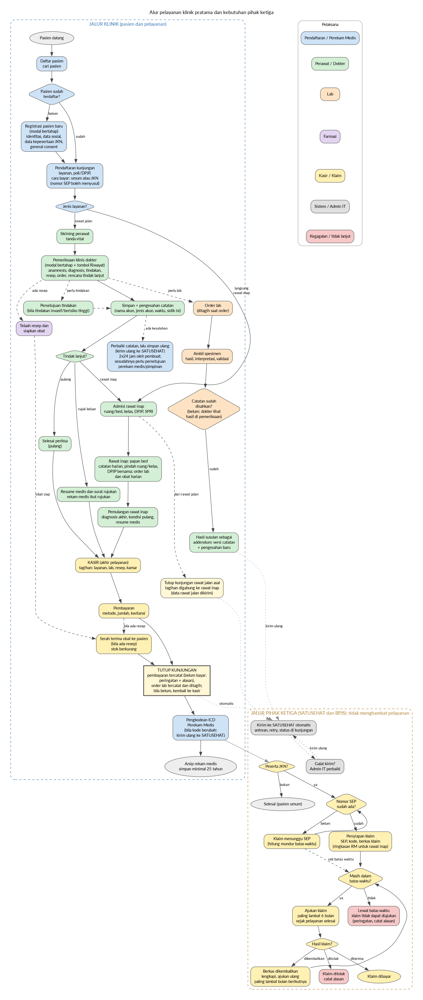

# Rancangan Aplikasi klira

Keputusan teknis. Dasar hukum dan alasannya ada di [regulasi.md](regulasi.md) bagian 8.

Fokus: klinik pratama (rawat jalan, rawat inap, farmasi, laboratorium, peserta JKN/BPJS). Satu aplikasi melayani banyak fasyankes (multi-tenant); satu fasyankes = satu Organization ID SATUSEHAT. Data dan backup di Indonesia.

## 0. Cakupan awal
| Tahap | Modul |
|---|---|
| 1 | Pendaftaran, Rawat Jalan, Rawat Inap, Farmasi, Laboratorium, Klaim JKN/BPJS, PDP, Integrasi SATUSEHAT |
| 2 | Modul program FKTP (ANC, imunisasi, MTBS, skrining PTM, TB, gizi, dll) dan klaim elektronik SATUSEHAT |
| Ditunda | IGD |

## 1. Fitur
Fitur dipisah menjadi **kegiatan utama klinik** (pekerjaan yang klinik jalankan sendiri) dan **kebutuhan pihak ketiga** (yang diminta atau dipakai pemerintah, penjamin, pasien sebagai pemilik data). Halaman dan modalnya ada di bagian 3.

### 1.1 Kegiatan utama klinik
| Fitur | Isi | Pengguna |
|---|---|---|
| Pendaftaran pasien | Registrasi identitas dan data sosial, cari pasien, pasien tanpa identitas, cara pembayaran | Petugas pendaftaran, perekam medis |
| Rawat jalan | Anamnesis, tanda vital, pemeriksaan, diagnosis, tindakan, rencana tindak lanjut, family folder | Dokter, perawat/bidan |
| Rawat inap | Admisi, ruang dan kelas, DPJP bersama, catatan harian, pemulangan, SPRI | Dokter, perawat |
| Laboratorium | Order, spesimen, hasil, interpretasi, validasi | Dokter, analis lab |
| Farmasi | Peresepan, telaah, pengeluaran obat, riwayat obat; master obat klinik (pilih dari Referensi KFA, atur harga dan satuan, nonaktifkan) | Dokter, apoteker |
| Dokumen klinis | Resume medis, surat rujukan, SPRI | Dokter, perawat |
| Tagihan dan kasir | Tagihan layanan, invoice, pembayaran | Petugas kasir |
| Pengkodean dan analisis | ICD-10, ICD-9 CM, pelaporan internal, analisis | Perekam medis |
| Pengelolaan rekam medis | Berkas kronologis, versi perbaikan (2x24 jam), pengesahan catatan | Perekam medis, nakes |
| Pengelolaan klinik | Pengguna dan akses, master data (poli, ruang, bed, praktisi, tarif, wilayah), profil klinik (SIP, akreditasi) | Pimpinan, admin IT |
| Keamanan, audit, dan penyimpanan data | Log audit, kebijakan akses, backup, data center di Indonesia, penanganan insiden siber, SMKI | Admin IT, admin vendor, auditor, pimpinan |
| PDP internal dan prosesor | Kebijakan retensi (RME 25 tahun), pemusnahan dan berita acara, ROPA, DPIA, prosesor (perjanjian, NDA, sub-prosesor, SLA) | Petugas PDP |
| Modul program FKTP (tahap 2) | ANC, imunisasi, MTBS, skrining PTM, TB, gizi, dll | Dokter, bidan |

### 1.2 Kebutuhan pihak ketiga
Vendor dan hosting tercakup di Keamanan, audit, dan penyimpanan data; PDP internal dan prosesor; serta Registrasi dan legalitas sistem.

#### Kemenkes / SATUSEHAT
| Fitur | Isi | Pengguna |
|---|---|---|
| Konfigurasi dan kredensial | Organization ID, Client ID/Secret terenkripsi, sandbox/production | Admin IT, admin vendor |
| Sinkronisasi master | Organization, Location, praktisi, pasien (IHS Number via NIK) | Admin IT |
| Sinkronisasi KFA | Ambil daftar obat dan alat kesehatan (kode KFA 91/92/93/94) dari API KFA: sinkronisasi awal lengkap lalu berkala per tanggal; harga JKN per regional; tandai obat di master klinik yang diganti atau tidak aktif | Admin IT, sistem |
| Pengiriman data | Kirim berurutan per kunjungan (rawat jalan, rawat inap, farmasi, lab) dengan antrean, retry, id balikan; waktu UTC+00; kode ICD, SNOMED, LOINC, KFA | Sistem, admin IT |
| Validasi dan galat | OperationOutcome, RuleNumber, path, pemetaan ke kamus | Admin IT |
| Registrasi dan legalitas sistem | Nomor PSE Komdigi, lisensi SNOMED, bukti sandbox, berkas, status verifikasi, registrasi Sistem Elektronik di Kemenkes | Admin vendor |
| KYC SATUSEHAT Mobile | Generate URL Validasi untuk verifikasi pengguna | Sistem |
| Pelaporan dan pemutakhiran data | Laporan eksternal ke Dinkes/Kemenkes, pemutakhiran data klinik lewat aplikasi Kemenkes, status akreditasi | Perekam medis, pimpinan |

#### BPJS Kesehatan (penjamin)
| Fitur | Isi | Pengguna |
|---|---|---|
| Klaim FKTP | Nomor SEP, kode diagnosis dan tindakan sama dengan rekam medis, FPK, rekapitulasi, kuitansi, surat tanggung jawab mutlak | Petugas klaim |
| Klaim rawat inap | Surat perintah rawat inap dan ringkasan rekam medis minimal | Petugas klaim, dokter |
| Siklus klaim | Batas 6 bulan, pengembalian berkas (berita acara), pengajuan ulang bulan berikutnya, status klaim | Petugas klaim |
| Permintaan data BPJS | Dokumen klaim softcopy/elektronik, ringkasan rekam medis, akses audit dengan menjaga kerahasiaan | Perekam medis |
| Klaim elektronik SATUSEHAT (tahap 2) | Bundle RME bertanda tangan ke klaim (sandbox, hanya menyebut FKRTL) | Sistem |

#### Fasyankes lain dan Puskesmas wilayah
| Fitur | Isi | Pengguna |
|---|---|---|
| Rujukan | Rekam medis sebagai bagian surat rujukan, transfer isi lewat platform Kemenkes | Dokter, perekam medis |
| Koordinasi Puskesmas wilayah | Data Puskesmas penanggung jawab wilayah, koordinasi sesuai ketentuan | Pimpinan |

#### Pasien dan wali (pemilik data)
| Fitur | Isi | Pengguna |
|---|---|---|
| Persetujuan | General consent, informed consent tindakan, persetujuan PDP, tarik persetujuan, bukti persetujuan | Petugas, dokter |
| Penyampaian rekam medis | Ke pasien saat pulang (rawat inap), elektronik atau cetak; ke wali/keluarga/pihak lain dengan persetujuan | Perekam medis |
| Hak data pasien | Akses, salinan, koreksi, hapus/musnah, batasi, ekspor, keberatan; tenggat 3x24 jam | Petugas PDP |
| Notifikasi kebocoran | Pemberitahuan tertulis ke pasien dan Lembaga, 3x24 jam; dokumentasi insiden | Petugas PDP |

#### Regulator dan pihak berwenang
| Fitur | Isi | Pengguna |
|---|---|---|
| Pembukaan rekam medis tanpa persetujuan | Penegakan hukum, etik/disiplin, audit medis, KLB/bencana, pendidikan/penelitian, ancaman keselamatan; identitas disamarkan; permintaan tertulis atau elektronik; terbatas sesuai kebutuhan | Pimpinan, perekam medis |
| Pemeriksaan Lembaga PDP | ROPA dan DPIA dapat ditunjukkan untuk pemeriksaan | Petugas PDP |

Kegiatan utama klinik tetap berjalan bila pihak ketiga tidak tersedia; yang terhenti hanya pengiriman dan klaim, yang kemudian diantre dan diulang.

## 2. Akun

Satu akun = satu orang. Akses ditetapkan bertingkat: jenis akun sebagai paket dasar, lalu tambahan atau pengurangan per akun.

### 2.0 Model akses
1. **Akun** milik satu orang, dengan **profil profesi** (nomor SIP, IHS Number praktisi) yang melekat pada orangnya, bukan pada jenis akun.
2. **Jenis akun** = paket izin siap pakai (tabel 2.1), bersifat **dinamis**: klinik bebas membuat, mengubah, dan menonaktifkan jenis akun serta isi izinnya. Saat klinik dibuat, aplikasi mengisi paket awal sebagai contoh; setelah itu semuanya milik klinik. Satu akun boleh punya beberapa jenis sekaligus (merangkap, tanpa batas jumlah), masing-masing berperiode mulai dan selesai sehingga rotasi tinggal mengganti periode.
3. **Izin tambahan atau pengurangan per akun**: pimpinan dapat menambah akses fitur lain, atau mencabut bagian dari paket dasar, lengkap dengan alasan dan periode.
4. Izin dinyatakan sebagai fitur x aksi (input, perbaikan, lihat) x cakupan (unit/layanan).
5. Akses efektif = gabungan semua jenis akun aktif, ditambah tambahan, dikurangi pengurangan. Aturan hukum tidak memblokir; aplikasi memberi peringatan (2.2).

### 2.1 Jenis akun (paket awal, bisa diubah)
| Akun | Fungsi |
|---|---|
| Admin vendor | Membuat tenant (fasyankes), kredensial SATUSEHAT, status registrasi sistem; tidak membaca isi rekam medis |
| Pimpinan fasyankes | Menetapkan hak akses dan SOP, menyetujui perbaikan data lewat 2x24 jam, menerima permintaan pembukaan rekam medis |
| Dokter/DPJP | Mengisi anamnesis, diagnosis, tindakan, resep, resume medis, persetujuan tindakan |
| Perawat/Bidan/Nakes lain | Mengisi catatan klinis, tanda vital, asesmen, catatan harian rawat inap |
| Perekam Medis dan Informasi Kesehatan | Registrasi, pengkodean ICD, pelaporan, analisis, perbaikan data, pembukaan rekam medis, transfer isi |
| Petugas pendaftaran | Registrasi pasien, general consent, data sosial |
| Petugas klaim/kasir | Data klaim, SEP, berkas klaim (FPK, rekap, kuitansi), invoice, pantau batas 6 bulan |
| Apoteker/tenaga kefarmasian | Telaah resep, pengeluaran obat |
| Analis lab | Pemeriksaan penunjang dan hasil |
| Admin IT fasyankes | Konfigurasi integrasi SATUSEHAT, master data, pantau antrean kirim |
| Petugas PDP (PPDP) | Permintaan hak pasien, ROPA, DPIA, insiden, retensi |
| Auditor | Hanya melihat log dan laporan |

### 2.2 Peringatan (bukan blokir)
Saat pimpinan memberi izin berisiko, aplikasi menampilkan peringatan, pimpinan boleh lanjut dengan **mengisi alasan**, dan peringatan serta alasannya tercatat di log audit dan terlihat dalam satu daftar untuk pimpinan dan auditor.

| Peringatan |
|---|
| Izin klinis (diagnosis, resep, resume medis) diberikan ke akun yang profilnya bukan dokter ber-SIP; pengeluaran obat ke akun yang bukan tenaga kefarmasian |
| Pembuat dan penyetuju perbaikan data setelah 2x24 jam adalah orang yang sama |
| Izin lihat tidak dibatasi ke pasien/unit yang sedang ditangani |
| Admin IT atau admin vendor diberi izin lihat isi rekam medis |
| Nakes tanpa SIP aktif diberi izin klinis |
| Penugasan jenis akun melewati masa berlaku SIP |

Peringatan muncul saat tindakannya terjadi, bukan saat jenis akun diberikan. Pimpinan dapat memilih **Terima untuk akun ini** dengan alasan sekali; peringatan berikutnya tidak menghalangi kerja tetapi tetap tercatat di audit dan daftar peringatan.

Data klinis tanpa IHS Number praktisi tidak terkirim ke SATUSEHAT: muncul sebagai gagal kirim, bukan blokir izin. Hapus data klinis tidak disediakan sebagai izin.

### 2.3 Atribut akun
- Identitas: nama, NIK, fasyankes, status aktif.
- Profil profesi: nomor SIP, IHS Number praktisi.
- Semua tindakan akun tercatat di log audit.
- Pasien/wali tidak punya akun; permintaan mereka dilayani lewat petugas PDP.

### 2.4 Akun pertama klinik
- Admin vendor membuat klinik (tenant) dan satu akun Pimpinan pertama dengan username dan password awal yang statis dan sama untuk semua klinik.
- Saat login pertama, **username dan password wajib diganti**; fitur lain tidak bisa dibuka sebelum diganti. Kredensial awal tidak berlaku lagi setelah diganti.
- Akun Pimpinan pertama itu mengatur semua akun lain (jenis akun, izin, penugasan); pemilik yang juga dokter diberi jenis Pimpinan dan Dokter.
- Pembuatan akun pertama, penggantian kredensial, dan login pertama tercatat di log audit.

## 3. Halaman dan modal
Bentuk tampilan mengikuti bagian 5 (UI dan UX). Halaman dibuat sedikit: tiap menu satu halaman, bagian-bagiannya berupa tab. Pekerjaan sehari-hari terjadi di modal yang dibuka dari Daftar pasien.

### 3.1 Halaman (menu)
| Halaman | Tab di dalamnya | Jenis akun | Fungsi |
|---|---|---|---|
| Masuk | Login; Ganti kredensial (wajib di login pertama akun awal) | Semua | Masuk dan ganti kredensial |
| Daftar pasien (halaman awal) | Filter bawaan per pekerjaan | Semua akun klinis dan administrasi | Pencarian dan antrean; titik buka semua modal pendaftaran dan pemeriksaan |
| Rawat inap | Papan bed | Dokter, perawat | Bed dan pasien, pindah ruang/kelas, catatan harian |
| Penunjang | Rekap lab; Master pemeriksaan | Analis lab, dokter | Rekap dan pengelolaan master; pekerjaan per pasien (order, spesimen, hasil) dibuka dari Daftar pasien |
| Farmasi | Riwayat obat; Master obat dan stok | Apoteker, dokter | Master obat tertaut KFA, stok, riwayat; telaah dan siapkan resep dibuka dari Daftar pasien |
| Kasir dan klaim | Shift dan rekap harian; Klaim JKN/BPJS | Petugas kasir/klaim | Shift kasir, rekap, berkas dan siklus klaim; pembayaran, serah terima obat (dua proses terpisah dalam satu modal bertahap), dan tutup kunjungan dibuka dari Daftar pasien |
| Rekam medis | Berkas pasien (kronologis, versi, pengesahan); Resume dan surat; Persetujuan; Permintaan pembukaan; Penyampaian; Pengkodean dan laporan; Antrean perbaikan | Dokter, perawat, perekam medis, pimpinan, auditor | Semua pengelolaan berkas rekam medis |
| SATUSEHAT | Konfigurasi; Sinkronisasi master dan KFA; Antrean kirim; Log dan galat; Registrasi sistem | Admin IT, admin vendor | Integrasi Kemenkes |
| Pelindungan data | Persetujuan dan pemberitahuan; Permintaan hak pasien; ROPA; DPIA; Insiden; Retensi dan pemusnahan; Prosesor | Petugas PDP, pimpinan | Pengelolaan data pribadi |
| Pengaturan | Pengguna dan akses; Jenis akun; Daftar peringatan izin; Master data (poli, ruang, bed, praktisi, tarif, wilayah); Profil klinik (SIP, akreditasi, Puskesmas wilayah); Keamanan (kebijakan akses, backup, insiden siber); Log audit | Pimpinan, admin IT, auditor | Akun dan pengaturan klinik |
| Beranda tugas | Tugas, status kirim, permintaan hak | Admin IT, admin vendor, petugas PDP | Pengganti Daftar pasien bagi akun yang tidak melihat rekam medis |

Total: 11 halaman. Semua pekerjaan per pasien (registrasi, kunjungan, skrining, pemeriksaan, lab, telaah resep, pembayaran, serah terima obat, tutup kunjungan) dibuka sebagai modal dari Daftar pasien. Halaman lain hanya untuk pekerjaan yang bukan per pasien (master, stok, rekap, klaim, pengelolaan). Peran harian cukup satu halaman; pengecualiannya perawat dan dokter rawat inap yang juga memakai papan bed di Rawat inap.

Halaman awal:
- Semua akun klinis dan administrasi memulai dari Daftar pasien (kotak pencarian dan daftar). Filter dan tindakan bawaan mengikuti pekerjaan: perawat melihat menunggu skrining, dokter menunggu pemeriksaan, farmasi resep menunggu, apoteker resep menunggu telaah dan serah terima, analis lab order menunggu, kasir menunggu pembayaran.
- Daftar hanya menampilkan data minimal (nama, nomor RM, status); isi rekam medis terbuka saat pasien dipilih dan pembukaannya tercatat.
- Admin IT, admin vendor, dan petugas PDP tidak memakai daftar pasien; halaman awal mereka adalah Beranda tugas.

### 3.2 Jenis modal dan komponen umum
| Jenis | Dipakai untuk |
|---|---|
| MODAL-1 | Satu layar, seluruh isian muat tanpa scroll |
| MODAL-BERTAHAP | Satu modal dengan langkah Lanjut/Kembali, daftar langkah bisa diklik, draf otomatis, ringkasan akhir |
| PANEL | Panel samping untuk riwayat atau info pendamping tanpa meninggalkan langkah (mis. tombol Riwayat pada pemeriksaan klinis) |

Aturan pemakaian:
- MODAL-1 bila seluruh tugas muat dalam satu layar tanpa scroll; MODAL-BERTAHAP bila tidak muat. Alur berurutan memakai satu modal yang sama dari awal sampai akhir, tanpa membuka modal lain; pemeriksaan klinis memakai bentuk ini sebagai bawaan.
- Modal bertahap menampilkan posisi langkah (mis. 2 dari 4), tombol Kembali, daftar langkah yang bisa diklik langsung (tidak wajib berurutan), simpan draf otomatis, dan ringkasan di langkah terakhir. Ringkasan pasien (identitas, alergi, diagnosis aktif) tetap terlihat di semua langkah.
- Hindari modal bertumpuk; isian yang belum disimpan dilindungi bila modal tertutup tanpa sengaja.

Tiga komponen umum dibuat sekali dan dipakai berulang, tidak didaftar sebagai modal sendiri-sendiri:
- **Konfirmasi:** dialog ya/tidak singkat (nonaktifkan, batalkan, ekspor, kirim, sahkan, tutup dengan draf), alasan opsional.
- **Peringatan:** dialog dengan alasan wajib dan tercatat; jenisnya mengikuti tabel 2.2 dan tambahan (batas klaim 6 bulan, kode klaim beda dari rekam medis, stok kurang, pembukaan tanpa dasar, ganti ke production, hapus sebelum retensi); pada alur bertahap tampil di langkah terakhir.
- **Panel detail:** tampilan baca-saja untuk riwayat versi, detail log audit dan galat, rincian tagihan, rincian kirim, akses efektif.

### 3.3 Modal formulir
#### Pelayanan klinik
| Modal | Dibuka dari | Jenis | Langkah |
|---|---|---|---|
| Registrasi pasien baru | Daftar pasien | MODAL-BERTAHAP | Cari duplikat > Identitas > Data sosial > Alamat dan jalur identitas khusus > Wali/keluarga > Cara pembayaran (data JKN) > General consent > Ringkasan |
| Pendaftaran kunjungan | Daftar pasien | MODAL-1 | Layanan, poli/DPJP, cara pembayaran, keluhan singkat |
| Pemeriksaan klinis | Daftar pasien | MODAL-BERTAHAP | Anamnesis > Tanda vital > Pemeriksaan > Diagnosis > Tindakan > Resep > Order penunjang > Rencana tindak lanjut > Ringkasan |
| Riwayat, Salin dari kunjungan sebelumnya, Favorit dan templat, Family folder | Pemeriksaan klinis, Daftar pasien | PANEL | Info pendamping tanpa menutup langkah aktif |
| Persetujuan tindakan | Pemeriksaan klinis, Rekam medis | MODAL-BERTAHAP | Tindakan > Penjelasan > Persetujuan > Ringkasan |
| Resume medis dan surat rujukan | Pemeriksaan klinis, Rekam medis | MODAL-BERTAHAP | Ringkasan > Tindak lanjut/rujukan > Surat lain > Ringkasan |
| Admisi rawat inap | Rawat inap, Pemeriksaan klinis | MODAL-BERTAHAP | Pasien > Ruang/bed dan kelas > DPJP > SPRI > Ringkasan (dari rawat jalan: kunjungan asal ditutup dan tagihan digabung) |
| Ubah penempatan | Rawat inap | MODAL-1 | Pindah ruang/kelas dan DPJP bersama |
| Catatan harian (CPPT) | Rawat inap | MODAL-1 | Catatan, tanda vital, pemberian obat oleh perawat |
| Pemulangan rawat inap | Rawat inap | MODAL-BERTAHAP | Ringkasan > Diagnosis akhir > Kondisi pulang > Tindak lanjut > Resume medis |
| Order lab | Daftar pasien, Pemeriksaan klinis | MODAL-1 | Pemeriksaan, prioritas, catatan |
| Ambil spesimen | Daftar pasien | MODAL-1 | Spesimen, waktu, petugas |
| Hasil lab | Daftar pasien | MODAL-BERTAHAP | Hasil > Interpretasi > Validasi |
| Telaah dan siapkan resep | Daftar pasien | MODAL-1 | Telaah (administratif, farmasetik, klinis), siapkan obat, tandai siap |
| Mutasi stok | Farmasi | MODAL-1 | Terima, keluar, koreksi: batch, kedaluwarsa, jumlah, alasan |
| Master obat | Farmasi, Pengaturan | MODAL-1 | Pilih dari Referensi KFA, satuan, harga, aktif |
| Perbaiki catatan; Tinjau permintaan perbaikan | Rekam medis | MODAL-1 | Bagian, isi baru, alasan; setujui atau tolak |

#### Kasir dan klaim
| Modal | Dibuka dari | Jenis | Langkah |
|---|---|---|---|
| Pembayaran dan serah terima obat | Daftar pasien | MODAL-BERTAHAP | Tagihan > Pembayaran (metode, jumlah, kwitansi) > Serah terima obat (bila ada resep; stok berkurang) |
| Tutup kunjungan | Daftar pasien | MODAL-1 | Periksa pembayaran dan order lab ditagih; belum bayar: peringatan dengan alasan |
| Buka dan tutup shift kasir | Kasir dan klaim | MODAL-1 | Kas awal, kas akhir, selisih dan alasan |
| Penyiapan klaim | Kasir dan klaim | MODAL-BERTAHAP | Kunjungan dan SEP > Diagnosis dan tindakan > Berkas klaim > Ringkasan |
| Ubah status klaim | Kasir dan klaim | MODAL-1 | Pengembalian berkas, pengajuan ulang, dibayar |

#### Rekam medis
| Modal | Dibuka dari | Jenis | Langkah |
|---|---|---|---|
| Permintaan pembukaan | Rekam medis | MODAL-BERTAHAP | Pemohon > Dasar > Cakupan > Ringkasan |
| Penyampaian rekam medis | Rekam medis | MODAL-1 | Penerima, bentuk, persetujuan |
| Pengkodean ICD; Buat laporan | Rekam medis | MODAL-1 | Kode diagnosis dan tindakan; jenis dan periode laporan |

#### Akun dan pengaturan
| Modal | Dibuka dari | Jenis | Langkah |
|---|---|---|---|
| Pembuatan akun dan penugasan | Pengaturan | MODAL-BERTAHAP | Data akun > Profil profesi > Jenis akun dan periode > Izin tambahan/pengurangan > Ringkasan dan peringatan |
| Atur izin akun; Buat atau ubah jenis akun | Pengaturan | MODAL-1 | Izin tambahan/pengurangan dengan alasan; nama, syarat profesi, daftar izin |
| Tambah atau ubah master/profil | Pengaturan | MODAL-1 | Satu bentuk untuk poli, ruang, bed, praktisi, jadwal praktik, tarif, SIP tenaga |
| Kebijakan akses, backup, data klinik | Pengaturan | isian langsung di halaman | Bukan modal |

#### SATUSEHAT
| Modal | Dibuka dari | Jenis | Langkah |
|---|---|---|---|
| Konfigurasi SATUSEHAT | SATUSEHAT | MODAL-1 | Organization ID, Client ID/Secret, lingkungan |
| Verifikasi pengguna SATUSEHAT Mobile (KYC) | SATUSEHAT | MODAL-1 | Generate URL Validasi |
| Registrasi sistem | SATUSEHAT | MODAL-BERTAHAP | Data sistem > Berkas > Bukti sandbox > Status |

#### Pelindungan data pribadi
| Modal | Dibuka dari | Jenis | Langkah |
|---|---|---|---|
| Permintaan hak pasien | Pelindungan data | MODAL-BERTAHAP | Catat: Pemohon > Jenis hak > Ringkasan; Proses: Tinjau > Keputusan > Pelaksanaan > Notifikasi |
| ROPA | Pelindungan data | MODAL-BERTAHAP | Pihak > Dasar dan data > Akses dan hak > Retensi dan pengamanan > Ringkasan |
| DPIA | Pelindungan data | MODAL-BERTAHAP | Risiko > Mitigasi > Saran PPDP > Tinjau ulang |
| Insiden kebocoran | Pelindungan data | MODAL-BERTAHAP | Kejadian > Dampak > Penanganan dan pemulihan > Notifikasi |
| Pemusnahan | Pelindungan data | MODAL-BERTAHAP | Pilih data > Perintah ke prosesor > Pelaksanaan > Berita acara |
| Prosesor | Pelindungan data | MODAL-BERTAHAP | Identitas > Perjanjian > Sub-prosesor dan SLA |
| Versi teks pemberitahuan; Catat tarik persetujuan | Pelindungan data | MODAL-1 | Teks berversi; pencatatan penarikan |

Ringkasan: 11 halaman dan 45 modal (18 bertahap, 23 satu layar, 4 panel) ditambah 3 komponen umum (Konfirmasi, Peringatan, Panel detail). Sebagian besar modal pelayanan klinik dibuka dari Daftar pasien.

## 4. Struktur data
Aturan umum:
- Catatan lama tidak berubah ketika peran seseorang berubah; pengesahan menyimpan satu jenis akun yang memberi hak untuk tindakan itu.
- Akun, jenis akun, dan penugasan tidak dihapus permanen: "hapus" berarti dinonaktifkan dan penugasan diakhiri dengan tanggal selesai, sehingga riwayat tetap utuh.
- Perubahan klinis berversi (tanpa DELETE); waktu disimpan UTC+00, tanggal tidak sebelum 2014-06-03; NIK 16 digit.
- Semua entitas membawa `fasyankes_id`, `dibuat_oleh`, `dibuat_pada`; data dan backup di Indonesia.

### 4.1 Entitas inti
| Entitas | Field kunci | Padanan SATUSEHAT |
|---|---|---|
| Fasyankes | id, nama, jenis (klinik pratama rawat jalan/rawat inap), bentuk usaha, kode registrasi, Organization ID, status akreditasi, Puskesmas penanggung jawab wilayah | Organization |
| Kredensial SATUSEHAT | fasyankes_id, environment, client_id, client_secret (terenkripsi) | otentikasi |
| Lokasi | id, fasyankes_id, jenis (poli/ruang/bed), induk, status operasional (U/O), IHS Location ID | Location |
| Pengguna | id, nama, NIK, username, status, wajib ganti kredensial (ya sampai login pertama selesai) | - |
| Profil profesi | pengguna_id, profesi, nomor SIP, masa berlaku SIP, IHS Practitioner ID | Practitioner |
| Pasien | id, nomor RM, NIK, nama, ibu kandung, tempat/tanggal lahir, jenis kelamin, agama, suku, bahasa, pekerjaan, pendidikan, status kawin, alamat dan kode wilayah, paspor/KITAS, IHS Number; data JKN: nomor kartu, kelas hak, FKTP terdaftar | Patient |
| Wali/keluarga | pasien_id, hubungan, nama, kontak | RelatedPerson |

### 4.1b Akses dan izin
| Entitas | Field kunci |
|---|---|
| Jenis akun | id, nama, syarat profesi (dasar peringatan), daftar izin paket, aktif, diubah_oleh, alasan perubahan; riwayat perubahan tersimpan |
| Izin | id, fitur/modul, aksi (input/perbaikan/lihat), cakupan (unit/layanan) |
| Penugasan jenis | pengguna_id, jenis_akun_id, mulai, selesai, ditetapkan_oleh |
| Izin per akun | pengguna_id, izin_id, tipe (tambah/kurang), alasan, mulai, selesai, ditetapkan_oleh |
| Peringatan izin | pengguna_id, izin atau penugasan, jenis peringatan, alasan pimpinan, ditetapkan_oleh, waktu |

### 4.2 Kunjungan dan klinis
| Entitas | Field kunci | Padanan |
|---|---|---|
| Kunjungan | id, pasien_id, jenis (AMB rawat jalan, IMP rawat inap), status (planned/arrived/in-progress/finished), tahap layanan (menunggu skrining, pemeriksaan, resep, kasir, ditutup), kunjungan asal (rawat jalan yang berlanjut ke rawat inap), waktu tutup, mulai, selesai, cara pembayaran, serviceType, Encounter ID | Encounter |
| Riwayat status dan lokasi (rawat inap) | kunjungan_id, lokasi_id, mulai, selesai, kelas (1/2/3/vip/vvip), indikator kelas | statusHistory, location[] |
| Peserta kunjungan | kunjungan_id, pengguna_id, tipe (ATND/SPRF), mulai, selesai | participant |
| Anamnesis | kunjungan_id, keluhan utama, penyerta, riwayat pribadi/keluarga, alergi | Condition, AllergyIntolerance |
| Observasi | kunjungan_id, kode LOINC, nilai, satuan UCUM, waktu | Observation |
| Diagnosis | kunjungan_id, kode ICD-10, padanan SNOMED, peran (CC/utama), urutan | Condition |
| Tindakan | kunjungan_id, kode ICD-9 CM, performer, mulai, selesai | Procedure |
| Tindak lanjut | kunjungan_id, jenis (rujuk/rawat inap/pulang), tujuan, SPRI | ServiceRequest |
| Pemulangan | kunjungan_id, disposisi (home/aadvice/other-hcf/exp-lt48h/exp-gt48h/oth), kondisi pulang | Encounter, Condition |
| Resume medis | kunjungan_id, bagian-bagian, penandatangan; untuk klaim rawat inap memuat ringkasan minimal | Composition |
| Versi catatan | entitas, entitas_id, isi lama, alasan perbaikan, disetujui_oleh | tidak dikirim |
| Pengesahan catatan | entitas, entitas_id, pengguna_id, jenis akun yang memberi hak untuk tindakan itu (satu saja, walau akun merangkap; semua jenis yang dirangkap ada di riwayat penugasan), waktu, hash isi | pengganti tanda tangan nakes; perubahan setelahnya terdeteksi |
| Jadwal praktik | pengguna_id, lokasi_id (poli), hari, jam mulai/selesai, kuota, berlaku dari/sampai | - |
| Antrean | kunjungan_id, lokasi_id, nomor, status (menunggu/dipanggil/dilayani/selesai/batal), waktu daftar, waktu panggil | - |
| Catatan harian rawat inap (CPPT) | kunjungan_id, pengguna_id, jenis akun pengesah, S/O/A/P, instruksi, waktu; disahkan per catatan | Observation, Condition |
| Order tindakan dan pemberian obat rawat inap | kunjungan_id, item resep atau tindakan, jadwal, dosis, waktu diberikan, pemberi (perawat), keterangan bila tidak diberikan | Procedure, MedicationAdministration |
| Addendum | kunjungan_id, entitas, isi susulan (mis. hasil lab setelah catatan disahkan), pengesahan baru, waktu; menambah versi catatan, tidak menimpa | Observation, DiagnosticReport (dikirim ulang) |
| Draf | alur (mis. pemeriksaan klinis), pengguna_id, kunjungan_id/pasien_id, langkah terakhir, isi sementara, diperbarui_pada | tidak dikirim; untuk simpan draf otomatis pada alur bermodal |

### 4.3 Penunjang dan farmasi
| Entitas | Field kunci | Padanan |
|---|---|---|
| Order penunjang | kunjungan_id, jenis, kode LOINC/ICD-9, prioritas, status (dipesan, spesimen diambil, menunggu hasil, divalidasi), tagihan dibuat saat order | ServiceRequest |
| Spesimen | order_id, asal, waktu ambil, petugas | Specimen |
| Hasil penunjang | order_id, nilai, interpretasi, validator | Observation, DiagnosticReport |
| Resep | kunjungan_id, DPJP, nomor resep, jenis pembiayaan, status (diajukan, ditelaah, siap, diserahkan di kasir); resep rawat inap dari catatan harian | MedicationRequest |
| Referensi KFA (statis) | kode, tingkat (91 bahan, 92 template, 93 produk, 94 kemasan), nama, bentuk sediaan, rute, satuan UCUM, kekuatan, nomor izin edar, produsen, generik, status, produk pengganti, waktu pembaruan; baca-saja, dari API KFA | Medication (kode) |
| Master obat klinik (dinamis) | id, kfa_id (wajib, satu kode KFA), nama tampil, satuan, harga (awal dapat dari harga JKN API KFA), aktif; tanpa obat ketik bebas | Medication |
| Item resep | resep_id, master_obat_id (kode KFA 92/93), aturan pakai, bentuk, rute, jumlah; racikan: bahan masing-masing berkode KFA | Medication (contained) |
| Telaah resep | resep_id, apoteker/petugas, kelengkapan (administratif, farmasetik, klinis), catatan, waktu | - |
| Stok obat (sederhana) | master_obat_id, batch, kedaluwarsa, jumlah; berkurang saat serah terima di kasir, bertambah saat penerimaan | - |
| Mutasi stok | stok_id, jenis (terima/keluar/koreksi), jumlah, alasan, pengguna_id, waktu | - |
| Pengeluaran obat (dicatat saat serah terima di kasir) | resep_id, kode KFA 93 (produk), jumlah, harga, substitusi, No SEP | MedicationDispense |

### 4.4 Persetujuan dan dokumen
| Entitas | Field kunci | Padanan |
|---|---|---|
| Persetujuan | pasien_id, jenis (general, tindakan, pembukaan, PDP), versi teks, tujuan, penjelasan yang diberikan, bentuk (tertulis/lisan), status, waktu, penandatangan (pasien/wali), saksi nakes | Consent |
| Pembukaan rekam medis | pasien_id, pemohon, dasar (persetujuan/hukum), cakupan, identitas disamarkan, waktu | tidak dikirim |

### 4.5 Klaim
| Entitas | Field kunci | Padanan |
|---|---|---|
| Klaim | kunjungan_id, nomor SEP, penjamin, kode diagnosis dan tindakan, status (menunggu SEP/siap diajukan/diajukan/dikembalikan/diajukan ulang/ditolak/dibayar/lewat batas waktu), alasan ditolak atau lewat batas, tanggal pelayanan selesai, batas pengajuan (6 bulan), FPK, rekapitulasi, kuitansi, surat tanggung jawab mutlak, berita acara pengembalian | Claim, ClaimResponse |
| Tagihan | kunjungan_id, item (layanan, lab, obat dari resep, kamar), harga, invoice; status tagihan (lengkap/belum) terpisah dari status pembayaran (belum/sebagian/lunas); rawat jalan yang berlanjut ke rawat inap digabung ke tagihan rawat inap | ChargeItem, Invoice, Account |
| Tarif layanan (master) | kode, nama, jenis (konsultasi, tindakan, lab, kamar), harga umum, harga JKN bila ada, aktif | - |
| Shift kasir | kasir_id, buka, tutup, kas awal, kas akhir, selisih, alasan selisih; rekap harian dihitung dari pembayaran | - |
| Pembayaran | tagihan_id, metode, jumlah, waktu, kasir, alasan bila kunjungan ditutup belum lunas (peringatan, tercatat di audit) | PaymentReconciliation |

### 4.6 Sinkronisasi SATUSEHAT
| Entitas | Field kunci |
|---|---|
| Antrean kirim | fasyankes_id, kunjungan_id, resource, payload, status, percobaan, kirim_pada; dibuat saat kunjungan ditutup, dan dibuat lagi bila ada addendum, perbaikan catatan, atau kode ICD berubah |
| Id balikan | entitas, entitas_id, resource_type, satusehat_id |
| Log galat | antrean_id, severity, code (duplicate/format/value), RuleNumber, path, pesan |
| Registrasi sistem | fasyankes_id, nomor PSE, status verifikasi, berkas, tanggal |

### 4.7 PDP dan audit
| Entitas | Field kunci |
|---|---|
| Log audit | pengguna_id, aksi (input/perbaikan/lihat/ekspor/pemusnahan), entitas, entitas_id, waktu, alamat |
| Permintaan hak subjek | pasien_id, jenis, diterima, batas waktu 3x24 jam, status, alasan penolakan |
| ROPA | fasyankes_id, tujuan, dasar, jenis data, kategori subjek, pihak akses, aliran, masa retensi, pengamanan, transfer |
| DPIA | pemrosesan, risiko, mitigasi, saran PPDP, tinjau ulang |
| Insiden | waktu diketahui, data terungkap, penanganan, notifikasi pasien dan Lembaga, waktu kirim |
| Kebijakan retensi | jenis data, periode (RME 25 tahun), dasar hukum, metode musnah |
| Pemusnahan | entitas, jadwal, berita acara, prosesor |
| Prosesor | nama, layanan, perjanjian, lokasi data |

### 4.8 Master terminologi
ICD-10, ICD-9 CM, ICD-O, SNOMED CT, LOINC, UCUM, KFA, wilayah Kemendagri. Versi kode mengikuti Standar Terminologi SATUSEHAT terbaru.

### 4.9 Yang masih kurang (entitas belum didefinisikan)
- Perbaikan: Permintaan perbaikan (pemohon, waktu, status, penyetuju).
- Lab: tahap dan status validasi order.
- Master pemeriksaan penunjang lokal (satuan, rentang rujukan); harganya di Tarif layanan.
- Tagihan: status pembayaran; Klaim: status per berkas, alasan pengembalian, jumlah dan tanggal bayar. Kuitansi dicetak dari pembayaran.
- Permintaan pembukaan (status, penyetuju), Penyampaian rekam medis, Laporan, KYC.
- Pasien: status identitas (lengkap/sementara), lampiran surat pengantar, penggabungan data ganda, field pasien tidak cakap dan wali; Keluarga dengan privasi per anggota.
- Persetujuan: master teks persetujuan berversi; Surat rujukan dan surat lain.
- PDP: Insiden dengan daftar pasien terdampak dan pembeda insiden siber; Permintaan hak dengan saluran masuk dan verifikasi identitas; Pemusnahan dengan perintah ke prosesor; Prosesor dengan sub-prosesor, SLA, butir perjanjian.
- Keamanan: Pengaturan keamanan, Riwayat backup; riwayat SIP dan tanggal akreditasi; penanda "dibatasi" pada rekaman.

## 5. UI dan UX
Tujuan: sedikit scroll, sedikit pindah halaman, sedikit pekerjaan berulang. Perangkat utama: komputer (layar lebar, keyboard dan mouse); tablet dan ponsel bukan target awal. Halaman awal dan aturan modal ada di bagian 3.

1. **Satu tempat per pekerjaan.** Dokter memeriksa dalam satu modal bertahap dengan tombol Riwayat, tanpa pindah halaman (langkah di bagian 3.3).
2. **Isi sekali, dipakai berulang.** Data klinis menjadi resume medis, ringkasan klaim, dan data kiriman SATUSEHAT tanpa input ulang.
3. **Sedikit scroll.** Ringkasan pasien selalu terlihat di atas; bagian jarang dipakai dilipat; urutan layar mengikuti alur kerja.
4. **Kurangi pengulangan.** Salin dari kunjungan sebelumnya, favorit diagnosis/tindakan/resep per dokter, pencarian cepat ICD dan KFA dengan saran otomatis, isian awal cerdas (waktu, lokasi, DPJP).
5. **Tampilan mengikuti akun.** Menu hanya menampilkan yang diizinkan; akun yang merangkap melihat gabungan akses semua jenis aktifnya.
6. **Keyboard diutamakan.** Tab antar isian, Enter atau pintasan untuk Lanjut, pintasan untuk Riwayat dan Simpan, kursor langsung di isian pertama tiap langkah.
7. **Status terlihat sepintas.** Status kirim SATUSEHAT dan klaim berupa penanda kecil di tiap kunjungan; halaman galat hanya dibuka bila ada yang perlu ditindaklanjuti.

### 5.1 Navigasi
a. Menu samping tetap di kiri dan hanya menampilkan halaman yang diizinkan bagi akun (bagian 2 dan prinsip 5).
b. Setelah masuk, akun klinis dan administrasi langsung ke Daftar pasien; akun tanpa akses rekam medis ke Beranda tugas.
c. Pekerjaan per pasien dibuka sebagai modal dari Daftar pasien, bukan halaman baru. Halaman lain hanya untuk pekerjaan yang bukan per pasien.
d. Modal bertahap: posisi langkah terlihat, daftar langkah bisa diklik, ringkasan pasien tetap terlihat, draf otomatis, dan penutupan tak sengaja dilindungi.
e. Tidak ada modal bertumpuk; info pendamping memakai panel samping.
f. Kunjungan dan antrean bergerak lewat filter tahap di Daftar pasien, bukan lewat pindah halaman.
g. Setelah modal ditutup, kembali ke Daftar pasien dengan pencarian, filter, dan posisi yang sama.
h. Filter bawaan sesuai pekerjaan akun dan diingat selama sesi; tab terakhir tiap halaman juga diingat.
i. Menu menampilkan jumlah yang menunggu (resep, pembayaran, galat kirim) agar status terlihat tanpa membuka halaman.
j. Tombol kembali pada peramban menutup modal atau panel yang terbuka, tidak keluar dari halaman.
k. Setiap pasien dan setiap halaman punya alamat tetap, sehingga bisa dibuka langsung dan dimuat ulang tanpa kehilangan posisi.
l. Pintasan keyboard: fokus pencarian pasien, Lanjut dan Kembali, Riwayat, Simpan; kursor langsung di isian pertama.
m. Halaman atau tombol yang tidak diizinkan tidak ditampilkan, bukan ditampilkan lalu ditolak; membuka alamatnya langsung menampilkan pesan tidak diizinkan dan tercatat di audit.
n. Sesi habis saat modal terbuka: isian tersimpan sebagai draf, lalu kembali ke tempat yang sama setelah masuk lagi.

### 5.2 Reusability
a. Semua nilai tampilan (warna, huruf, jarak, radius, bayangan) hanya didefinisikan di `apps/web/src/gaya` sebagai token. Halaman, modal, dan komponen tidak boleh menulis nilai warna atau ukuran langsung.
b. Semua elemen dasar (tombol, isian, tabel, lencana, kartu, tab, dialog) dibuat sekali di `apps/web/src/komponen/ui` dan dipakai di mana saja. Mengubah gaya tombol cukup di satu berkas.
c. Kerangka modal (MODAL-1, MODAL-BERTAHAP, PANEL) dan tiga komponen umum (Konfirmasi, Peringatan, Panel detail) dipakai semua modal; modal hanya mengisi isi dan langkahnya.
d. Label dan warna status (kunjungan, tagihan, pembayaran, klaim, kirim) dipetakan sekali di `packages/shared/status.ts`, dipakai API dan web.
e. Skema validasi dan tipe entitas satu sumber di `packages/shared`; API dan web tidak mengulang definisi.
f. Teks antarmuka yang berulang (label tombol, pesan galat, peringatan) disimpan di satu berkas teks, bukan ditulis di tiap layar.
g. Bagian logika yang dipakai lebih dari dua tempat dipindah ke `util` atau `layanan` yang dipakai bersama.

## 6. Keputusan
- Klinik pratama dengan rawat jalan, rawat inap, farmasi, laboratorium, peserta JKN/BPJS; perangkat komputer.
- Model akses seperti bagian 2 (jenis akun dinamis, merangkap, izin tambahan atau pengurangan, peringatan bukan blokir); akses efektif = gabungan semua jenis akun aktif.
- Tanpa portal pasien dan tanpa tanda tangan elektronik; pengesahan catatan menggantikan tanda tangan nakes (bagian 4.2).
- Akses darurat belum dimasukkan.
- Stok obat sederhana (batch, kedaluwarsa, mutasi); pengesahan per catatan oleh nakes yang mengisi; izin per bagian modal; pengurangan izin menang atas tambahan.
- Belum diputuskan: penanda interaksi atau alergi obat, ekspor log audit, reset kredensial akun, kebijakan sesi, aktifkan ulang akun, notifikasi publik insiden, penetapan PPDP, apakah pemohon perbaikan harus nakes pembuat catatan, rincian persetujuan anak dan disabilitas.
- Menunggu bahan: elemen wajib per resource SATUSEHAT, Standar Terminologi, bahan resmi bridging BPJS.

## 7. Ilustrasi alur pelayanan


Sumber gambar (dapat diedit): `ilustrasi/alur-pelayanan.dot`; versi vektor: `ilustrasi/alur-pelayanan.svg`. Satu diagram dengan dua jalur: **jalur klinik** (pasien dan pelayanan) dan **jalur pihak ketiga** (SATUSEHAT dan BPJS). Jalur pihak ketiga hanya menerima pemicu dari klinik dan tidak pernah menahan pelayanan, sehingga keduanya dapat dikembangkan terpisah. Warna menunjukkan pelaksana (merah = kegagalan atau tidak lanjut); garis putus-putus = langkah yang hanya terjadi bila perlu; garis titik-titik = proses otomatis sistem.

Alur singkat: pasien dicari di Daftar pasien (baru: registrasi dan general consent), didaftarkan kunjungan (rawat jalan atau langsung rawat inap), skrining perawat, pemeriksaan dokter dengan cabang lab, persetujuan tindakan, dan resep. Simpan berarti pengesahan catatan. Tindak lanjut: pulang, rujuk keluar, atau rawat inap sampai pemulangan. Semua berakhir di **kasir** (pembayaran dan serah terima obat), lalu **tutup kunjungan**, pengkodean ICD, dan arsip. Setelah itu jalur pihak ketiga berjalan: kirim SATUSEHAT, dan klaim bila peserta JKN.

Aturan alur yang ditetapkan lewat simulasi logika:
- **Kasir adalah stasiun terakhir.** Pembayaran dan serah terima obat terjadi di kasir pada akhir pelayanan, tetapi tetap dua proses terpisah di alur dan data (satu modal bertahap boleh memuat keduanya). Farmasi hanya menelaah resep dan menyiapkan obat; pengeluaran obat dicatat saat serah terima di kasir.
- **Tutup kunjungan** adalah satu peristiwa yang memeriksa pembayaran tercatat (belum bayar: peringatan dan alasan) dan semua order lab tercatat dan ditagih. Tidak menunggu hasil lab. Bila belum terpenuhi, kembali ke kasir.
- **Hasil lab susulan** setelah catatan disahkan dicatat sebagai addendum (versi catatan dan pengesahan baru) lalu dikirim ulang. Hasil sebelum disahkan dilihat dokter di pemeriksaan. Biaya lab masuk tagihan saat order.
- **Rawat jalan ke rawat inap:** kunjungan rawat jalan ditutup saat admisi, tagihannya digabung ke rawat inap, dan data rawat jalan dikirim; pasien juga bisa langsung rawat inap. Rawat inap dapat memesan lab dan obat harian.
- **SATUSEHAT:** kirim otomatis saat kunjungan ditutup, bukan tiap kali menyimpan. Kirim ulang bila ada addendum, perbaikan catatan (2x24 jam oleh pembuat, sesudahnya persetujuan), atau kode ICD berubah; galat kirim ditangani admin IT.
- **Arsip tidak menunggu klaim.** Arsip rekam medis mengikuti pengkodean; klaim berjalan di jalur pihak ketiga.
- **Siklus klaim** punya pagar: nomor SEP boleh menyusul (klaim menunggu SEP), pengajuan harus dalam batas waktu (6 bulan, ajukan ulang paling lambat pada pengajuan bulan berikutnya), dan ada cabang lewat batas waktu serta ditolak. Pasien umum langsung selesai.

## 8. Teknologi dan struktur folder
### 8.1 Teknologi
a. Bahasa: Node.js dengan TypeScript
b. Repo: npm workspaces
c. API: Express
d. Web: React dengan Vite
e. Validasi: Zod
f. Basis data: MySQL
g. Akses data: Prisma
h. Antrean kerja: BullMQ dengan Redis
i. Uji: Jest

### 8.2 Struktur folder
```
klira/
├── dokumen/
├── apps/
│   ├── api/
│   ├── worker/
│   └── web/
├── packages/
│   ├── shared/
│   ├── db/
│   └── integrasi/
├── package.json
└── tsconfig.base.json
```

a. apps/api
```
src/
├── main.ts
├── app.ts
├── config/
├── middleware/        auth, izin, audit, galat
└── modul/
    ├── akses/
    ├── pasien/
    ├── kunjungan/
    ├── klinis/
    ├── rawat-inap/
    ├── penunjang/
    ├── farmasi/
    ├── kasir/
    ├── klaim/
    ├── rekam-medis/
    ├── persetujuan/
    └── pdp/
```
Isi tiap modul: rute.ts, layanan.ts, repositori.ts, skema.ts, *.test.ts. Rute memanggil layanan, layanan memanggil repositori, hanya repositori yang menyentuh basis data.

b. apps/worker
```
src/
├── main.ts
├── penjadwal.ts
└── tugas/             kirim-satusehat, sinkron-master, pengingat, backup
```

c. apps/web
```
src/
├── main.tsx
├── app.tsx
├── halaman/           11 halaman bagian 3.1
├── modal/             pelayanan-klinik, kasir-klaim, rekam-medis,
│                      akun-pengaturan, satusehat, pelindungan-data
├── komponen/          modal-1, modal-bertahap, panel, konfirmasi,
│                      peringatan, panel-detail, ui
├── gaya/              token tampilan (satu-satunya tempat nilai warna dan ukuran)
├── api-klien/
└── util/
```

d. packages
```
shared/src/            skema/, izin.ts, status.ts, tipe.ts
db/                    prisma/schema.prisma, prisma/migrations/, seed/
integrasi/src/         satusehat/, bpjs/, umum/
```

### 8.3 Urutan membangun
a. Fondasi: repo, shared, db, login, izin, audit
b. Alur inti rawat jalan: Daftar pasien, registrasi, kunjungan, pemeriksaan, pengesahan, resep, order lab
c. Kasir: tagihan, pembayaran, serah terima obat, tutup kunjungan, shift
d. Rekam medis: versi, perbaikan, addendum, pengkodean, arsip
e. Rawat inap
f. Pihak ketiga: kirim SATUSEHAT, lalu klaim BPJS
g. PDP dan pengaturan lanjutan

### 8.4 Port dan alamat pengembangan
a. Port default aplikasi: 8074 (satu port; API melayani `/api`, dan antarmuka hasil build dilayani dari port yang sama).
b. Alamat pengembangan: https://klira.nuscode.id lewat tunnel ke `localhost:8074`.
c. HTTPS diakhiri di tunnel; aplikasi berjalan HTTP di lokal dan memercayai proxy (cookie sesi `secure`, alamat dasar dari konfigurasi).
d. Port dan alamat dasar dibaca dari konfigurasi lingkungan, bukan ditulis di kode.
